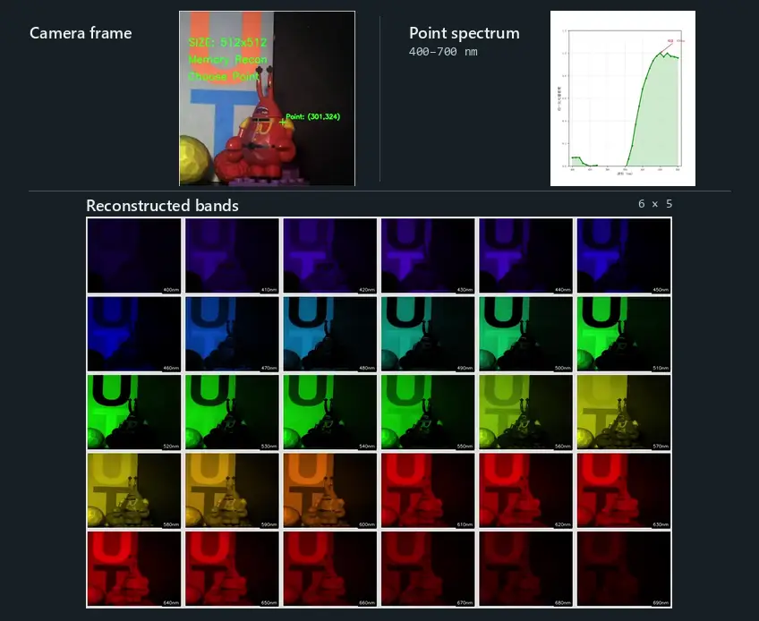
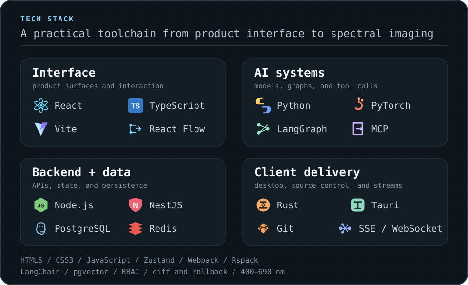
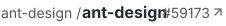
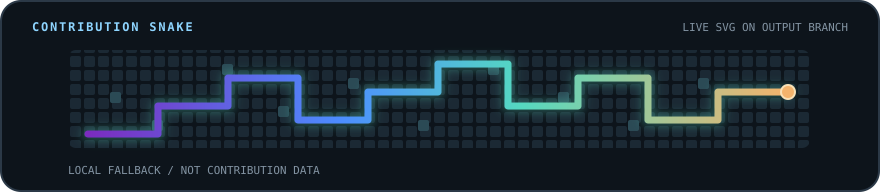
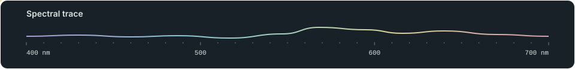

<h1 align="center">
  
  <picture>
    <source media="(max-width: 900px)" srcset="assets/spectral-intro-compact.svg">
    
  </picture>
</h1>

## Hyperspectral reconstruction demo

[Play full demo · 10.75 s](https://cdn.jsdelivr.net/gh/dvd233/dvd233@23d05a9d5212d37684a810c4c28137d881070098/assets/demo-sanitized-1080p60-muted.mp4) · [Still frame](https://github.com/dvd233/dvd233/blob/cb92e3eb0c7bacf655d355e856b35d2cde9550f4/assets/demo-poster-1920x1080.png)

The desktop prototype reconstructs 30 spectral bands from a camera frame and plots the spectrum at a selected pixel.

  <a href="https://cdn.jsdelivr.net/gh/dvd233/dvd233@23d05a9d5212d37684a810c4c28137d881070098/assets/demo-sanitized-1080p60-muted.mp4">
    <picture><source media="(max-width: 650px)" srcset="assets/demo-compact.webp"></picture>
  </a>

**Reconstruction** · I was responsible for the lightweight reconstruction model and dataset. 
**Desktop** · I built modules for camera capture, the desktop interface, spectral plots and saving results.

This public demo shows an earlier private prototype. Its code and data remain private.

[GitHub animation · 23.4 MiB](https://github.com/dvd233/dvd233/blob/23d05a9d5212d37684a810c4c28137d881070098/assets/demo-loop.webp) · [Download MP4 · 3.45 MiB](https://github.com/dvd233/dvd233/raw/23d05a9d5212d37684a810c4c28137d881070098/assets/demo-sanitized-1080p60-muted.mp4) (1080p, 60 fps)

Merged upstream fix · [Qwen Code #11300 — preserving commits after a failed checkout](https://github.com/QwenLM/qwen-code/pull/11300)

### Selected engineering work

  
  
  

- **Qwen Code** · A post-checkout hook can commit to the new branch and then fail. The old rollback deleted that branch even when it was the only ref keeping the commit reachable.
- **WeKnora** · Four standalone quantities survive PDF cleanup. Page numbers and chart labels are filtered when the surrounding layout identifies them.
- **OpenViking** · New memory injections use <code>plugin:openviking-memory</code>. Older sessions still replay with the legacy tag. This merged PR was AI-generated.

 ⭐ Upstream repository stars

<code>AI applications</code> &nbsp; <code>frontend + client systems</code> &nbsp; <code>agent workflows</code> &nbsp; <code>computational imaging</code>

## Tech stack

React and TypeScript · Python and PyTorch · Node.js and PostgreSQL · Rust and Tauri

**Frontend** · [Ant Design X #2066](https://github.com/ant-design/x/pull/2066) · Prevented an older request’s error from clearing a newer request’s loading state.

  <picture><source media="(max-width: 650px)" srcset="assets/tech-stack-compact.svg"></picture>

AI development tools (8)

  <a href="https://github.com/MoonshotAI/kimi-cli" title="Kimi Code"><picture><source media="(max-width: 360px)" srcset="assets/tool-kimi.svg" width="113" height="44"></picture></a>
  <a href="https://github.com/openai/codex" title="Codex"><picture><source media="(max-width: 360px)" srcset="assets/tool-codex.svg" width="113" height="44"></picture></a>
  <a href="https://pi.dev/" title="Pi"><picture><source media="(max-width: 360px)" srcset="assets/tool-pi.svg" width="113" height="44"></picture></a>
  <a href="https://github.com/anthropics/claude-code" title="Claude Code"><picture><source media="(max-width: 360px)" srcset="assets/tool-claude.svg" width="113" height="44"></picture></a> 
  <a href="https://github.com/NousResearch/hermes-agent" title="Hermes"><picture><source media="(max-width: 360px)" srcset="assets/tool-hermes.svg" width="113" height="44"></picture></a>
  <a href="https://github.com/anomalyco/opencode" title="OpenCode"><picture><source media="(max-width: 360px)" srcset="assets/tool-opencode.svg" width="113" height="44"></picture></a>
  <a href="https://github.com/zai-org/zcode-plugins" title="ZCode"><picture><source media="(max-width: 360px)" srcset="assets/tool-zcode.svg" width="113" height="44"></picture></a>
  <a href="https://github.com/deepseek-ai/deepseek-harness" title="DeepSeek Harness"><picture><source media="(max-width: 360px)" srcset="assets/tool-deepseek-harness.svg" width="113" height="44"></picture></a>

## 🌐 Open-source contributions

I contribute fixes and features focused on agent interoperability, reliable developer tools, and frontend interactions.

### 🏆 Merged contributions

⭐ opens the upstream repository, where GitHub displays its current star count.

💬  &nbsp;<a href="https://github.com/QwenLM/qwen-code" title="Upstream stars for QwenLM/qwen-code"><kbd>⭐ <!--stars:QwenLM/qwen-code-->30.9k<!--/stars--></kbd></a> 
Kept hook-created commits reachable after a failed checkout <a href="https://github.com/QwenLM/qwen-code/pull/11300" title="QwenLM/qwen-code#11300"><kbd>#11300</kbd></a>.

Rollback test · 7 more PRs

When a checkout hook commits and then fails, its commit stays reachable on the new branch. If the hook fails without moving the branch tip, rollback deletes the new branch.

<ul>
  <li>Preserved discovered MCP registration URLs <a href="https://github.com/QwenLM/qwen-code/pull/12205" title="QwenLM/qwen-code#12205"><kbd>#12205</kbd></a> and kept tools available when a server lacked an optional method <a href="https://github.com/QwenLM/qwen-code/pull/12500" title="QwenLM/qwen-code#12500"><kbd>#12500</kbd></a>.</li>
  <li>Disabled LSP for the ACP configuration used in MCP discovery <a href="https://github.com/QwenLM/qwen-code/pull/12256" title="QwenLM/qwen-code#12256"><kbd>#12256</kbd></a>, isolated npm packaging diagnostics from verifier output <a href="https://github.com/QwenLM/qwen-code/pull/12367" title="QwenLM/qwen-code#12367"><kbd>#12367</kbd></a>, and documented ACP writer recovery after an ungraceful shutdown <a href="https://github.com/QwenLM/qwen-code/pull/12268" title="QwenLM/qwen-code#12268"><kbd>#12268</kbd></a>.</li>
  <li>Recognized read-only <code>sed</code> aliases <a href="https://github.com/QwenLM/qwen-code/pull/12221" title="QwenLM/qwen-code#12221"><kbd>#12221</kbd></a> and tested deferred MCP tool calls in the SDK end to end <a href="https://github.com/QwenLM/qwen-code/pull/12365" title="QwenLM/qwen-code#12365"><kbd>#12365</kbd></a>.</li>
</ul>

📖  &nbsp;<a href="https://github.com/Tencent/WeKnora" title="Upstream stars for Tencent/WeKnora"><kbd>⭐ <!--stars:Tencent/WeKnora-->38.1k<!--/stars--></kbd></a> 
Fixed PDF text extraction that dropped all four values in a quantity column <a href="https://github.com/Tencent/WeKnora/pull/3228" title="Tencent/WeKnora#3228"><kbd>#3228</kbd></a>.

PDF cleanup test · 5 more PRs

The old parser dropped four standalone values under <code>Quantity</code>. The regression test checks that the extracted text retains all four (124, 237, 68 and 91).

<ul>
  <li>Exposed structured wiki output in MCP results <a href="https://github.com/Tencent/WeKnora/pull/3590" title="Tencent/WeKnora#3590"><kbd>#3590</kbd></a>.</li>
  <li>Reported host-project lookup failures <a href="https://github.com/Tencent/WeKnora/pull/3611" title="Tencent/WeKnora#3611"><kbd>#3611</kbd></a> and interrupted pagination reads <a href="https://github.com/Tencent/WeKnora/pull/3983" title="Tencent/WeKnora#3983"><kbd>#3983</kbd></a>, and restored paginated results in CLI text mode <a href="https://github.com/Tencent/WeKnora/pull/3984" title="Tencent/WeKnora#3984"><kbd>#3984</kbd></a>.</li>
  <li>Kept the caret in place when outdenting Markdown lists <a href="https://github.com/Tencent/WeKnora/pull/4071" title="Tencent/WeKnora#4071"><kbd>#4071</kbd></a>.</li>
</ul>

🧠  &nbsp;<a href="https://github.com/volcengine/OpenViking" title="Upstream stars for volcengine/OpenViking"><kbd>⭐ <!--stars:volcengine/OpenViking-->42.6k<!--/stars--></kbd></a> 
An AI-generated fix restored DeepSeek Harness memory injection with legacy replay support <a href="https://github.com/volcengine/OpenViking/pull/5318" title="volcengine/OpenViking#5318"><kbd>#5318</kbd></a>.

2 more AI-generated PRs

<ul>
  <li>Kept broad MCP recall queries from being narrowed to the process workspace <a href="https://github.com/volcengine/OpenViking/pull/5346" title="volcengine/OpenViking#5346"><kbd>#5346</kbd></a>.</li>
  <li>Excluded captured message parts from OpenCode plugin state snapshots <a href="https://github.com/volcengine/OpenViking/pull/5179" title="volcengine/OpenViking#5179"><kbd>#5179</kbd></a>.</li>
</ul>

🔍  &nbsp;<a href="https://github.com/alibaba/open-code-review" title="Upstream stars for alibaba/open-code-review"><kbd>⭐ <!--stars:alibaba/open-code-review-->55.6k<!--/stars--></kbd></a> 
Kept interrupted writes from truncating existing reports <a href="https://github.com/alibaba/open-code-review/pull/1160" title="alibaba/open-code-review#1160"><kbd>#1160</kbd></a>.

4 more PRs · configuration, templates and viewer

<ul>
  <li>Preserved unknown provider and MCP fields during configuration updates <a href="https://github.com/alibaba/open-code-review/pull/1508" title="alibaba/open-code-review#1508"><kbd>#1508</kbd></a>.</li>
  <li>Added Pug <a href="https://github.com/alibaba/open-code-review/pull/1114" title="alibaba/open-code-review#1114"><kbd>#1114</kbd></a> and Jinja <a href="https://github.com/alibaba/open-code-review/pull/1056" title="alibaba/open-code-review#1056"><kbd>#1056</kbd></a> template support.</li>
  <li>Wrapped long session metadata on mobile <a href="https://github.com/alibaba/open-code-review/pull/1458" title="alibaba/open-code-review#1458"><kbd>#1458</kbd></a>.</li>
</ul>

🛠️  &nbsp;<a href="https://github.com/Tencent/teamai-cli" title="Upstream stars for Tencent/teamai-cli"><kbd>⭐ <!--stars:Tencent/teamai-cli-->5.9k<!--/stars--></kbd></a> 
Protected local edits when pushing to an explicit team branch <a href="https://github.com/Tencent/teamai-cli/pull/690" title="Tencent/teamai-cli#690"><kbd>#690</kbd></a>.

8 more PRs · sync and agent hooks

<ul>
  <li>Kept configuration changes on the branch selected for a push <a href="https://github.com/Tencent/teamai-cli/pull/820" title="Tencent/teamai-cli#820"><kbd>#820</kbd></a>.</li>
  <li>Added opt-in DeepSeek Harness hooks with uninstall cleanup <a href="https://github.com/Tencent/teamai-cli/pull/689" title="Tencent/teamai-cli#689"><kbd>#689</kbd></a>.</li>
  <li>Mirrored deleted files during a push <a href="https://github.com/Tencent/teamai-cli/pull/651" title="Tencent/teamai-cli#651"><kbd>#651</kbd></a> and preserved namespaced rule destinations <a href="https://github.com/Tencent/teamai-cli/pull/654" title="Tencent/teamai-cli#654"><kbd>#654</kbd></a>.</li>
  <li>Pulled shared root instructions <a href="https://github.com/Tencent/teamai-cli/pull/653" title="Tencent/teamai-cli#653"><kbd>#653</kbd></a> and anchored project-relative documentation paths <a href="https://github.com/Tencent/teamai-cli/pull/652" title="Tencent/teamai-cli#652"><kbd>#652</kbd></a>.</li>
  <li>Cleaned up OpenCode hook listeners <a href="https://github.com/Tencent/teamai-cli/pull/688" title="Tencent/teamai-cli#688"><kbd>#688</kbd></a> and preserved additional roles selected during initialization <a href="https://github.com/Tencent/teamai-cli/pull/765" title="Tencent/teamai-cli#765"><kbd>#765</kbd></a>.</li>
</ul>

🤖  &nbsp;<a href="https://github.com/agentscope-ai/agentscope" title="Upstream stars for agentscope-ai/agentscope"><kbd>⭐ <!--stars:agentscope-ai/agentscope-->36.5k<!--/stars--></kbd></a> 
Preserved tool data-block IDs when replay merged streamed Base64 chunks <a href="https://github.com/agentscope-ai/agentscope/pull/2551" title="agentscope-ai/agentscope#2551"><kbd>#2551</kbd></a>.

1 more PR · Windows example server

<ul>
  <li>Restored subprocess execution in the Windows example server by disabling hot reload <a href="https://github.com/agentscope-ai/agentscope/pull/2434" title="agentscope-ai/agentscope#2434"><kbd>#2434</kbd></a>.</li>
</ul>

🤖  &nbsp;<a href="https://github.com/ant-design/x" title="Upstream stars for ant-design/x"><kbd>⭐ <!--stars:ant-design/x-->4.9k<!--/stars--></kbd></a> 
Fixed <code>XRequest</code> loading state after JSON business errors, without letting stale failures finish newer requests.

📱  &nbsp;<a href="https://github.com/NervJS/taro" title="Upstream stars for NervJS/taro"><kbd>⭐ <!--stars:NervJS/taro-->37.8k<!--/stars--></kbd></a> 
Emitted a stylesheet for every mini-program page sharing a CSS asset <a href="https://github.com/NervJS/taro/pull/19492" title="NervJS/taro#19492"><kbd>#19492</kbd></a>.

7 more PRs · components, mini-programs and React Native

<ul>
  <li>Centered <code>aspectFit</code> images horizontally <a href="https://github.com/NervJS/taro/pull/19491" title="NervJS/taro#19491"><kbd>#19491</kbd></a>.</li>
  <li>Supported the phone-number quota toast on WeChat <a href="https://github.com/NervJS/taro/pull/19493" title="NervJS/taro#19493"><kbd>#19493</kbd></a> and the hold-keyboard input prop on Swan <a href="https://github.com/NervJS/taro/pull/19494" title="NervJS/taro#19494"><kbd>#19494</kbd></a>.</li>
  <li>Fixed request declarations <a href="https://github.com/NervJS/taro/pull/19495" title="NervJS/taro#19495"><kbd>#19495</kbd></a> and added <code>requestCommonPayment</code> typings <a href="https://github.com/NervJS/taro/pull/19496" title="NervJS/taro#19496"><kbd>#19496</kbd></a>.</li>
  <li>Preserved real upload filenames in React Native <a href="https://github.com/NervJS/taro/pull/19507" title="NervJS/taro#19507"><kbd>#19507</kbd></a> and installed the missing Babel preset <a href="https://github.com/NervJS/taro/pull/19521" title="NervJS/taro#19521"><kbd>#19521</kbd></a>.</li>
</ul>

🧪  &nbsp;<a href="https://github.com/PKU-YuanGroup/OpenAI4S" title="Upstream stars for PKU-YuanGroup/OpenAI4S"><kbd>⭐ <!--stars:PKU-YuanGroup/OpenAI4S-->670<!--/stars--></kbd></a> 
Prevented stale execution-history responses from replacing newer cells through per-frame request ownership, with unit and browser regression coverage.

📊  &nbsp;<a href="https://github.com/grafana/grafana-pathfinder-app" title="Upstream stars for grafana/grafana-pathfinder-app"><kbd>⭐ <!--stars:grafana/grafana-pathfinder-app-->23<!--/stars--></kbd></a> 
Made bulk deletion of root and nested blocks undoable in one step <a href="https://github.com/grafana/grafana-pathfinder-app/pull/1890" title="grafana/grafana-pathfinder-app#1890"><kbd>#1890</kbd></a>.

Project notes · 31 merged PRs

<ul>
  <li>A single selection can include root blocks, section children and conditional-branch blocks. The editor asks for confirmation before applying that selection as one edit.</li>
  <li>Across 31 merged PRs, the work also covered the coda VM lifecycle, documentation retrieval, lint and end-to-end coverage.</li>
</ul>

🧱  &nbsp;<a href="https://github.com/mui/material-ui" title="Upstream stars for mui/material-ui"><kbd>⭐ <!--stars:mui/material-ui-->99.4k<!--/stars--></kbd></a> 
Fixed inline completion for automatically highlighted Autocomplete options, while preserving typed input, text selection, and freeSolo behavior.

🔗  &nbsp;<a href="https://github.com/CopilotKit/CopilotKit" title="Upstream stars for CopilotKit/CopilotKit"><kbd>⭐ <!--stars:CopilotKit/CopilotKit-->38.9k<!--/stars--></kbd></a> 
Added CI coverage for native Strands tool lifecycles in a separate test process, checking state and history restoration, generated IDs, and session isolation.

🔬  &nbsp;<a href="https://github.com/web-infra-dev/rsdoctor" title="Upstream stars for web-infra-dev/rsdoctor"><kbd>⭐ <!--stars:web-infra-dev/rsdoctor-->1.2k<!--/stars--></kbd></a> 
Restored Windows module-size measurements that incorrectly stayed at zero <a href="https://github.com/web-infra-dev/rsdoctor/pull/2102" title="web-infra-dev/rsdoctor#2102"><kbd>#2102</kbd></a>.

2 more PRs · bundle analysis

<ul>
  <li>Applied the selected units to bundle-size filters <a href="https://github.com/web-infra-dev/rsdoctor/pull/2075" title="web-infra-dev/rsdoctor#2075"><kbd>#2075</kbd></a>.</li>
  <li>Made module trees sortable by bundled size or source size <a href="https://github.com/web-infra-dev/rsdoctor/pull/2101" title="web-infra-dev/rsdoctor#2101"><kbd>#2101</kbd></a>.</li>
</ul>

⚛️  &nbsp;<a href="https://github.com/alibaba/hooks" title="Upstream stars for alibaba/hooks"><kbd>⭐ <!--stars:alibaba/hooks-->15.0k<!--/stars--></kbd></a> 
Reset <code>loadingMore</code> after cancellation so infinite scrolling can resume <a href="https://github.com/alibaba/hooks/pull/2970" title="alibaba/hooks#2970"><kbd>#2970</kbd></a>.

2 more PRs · types and storage

<ul>
  <li>Preserved non-nullable ref return types and covered them with declaration-emission regression tests <a href="https://github.com/alibaba/hooks/pull/2956" title="alibaba/hooks#2956"><kbd>#2956</kbd></a>.</li>
  <li>Clarified the synchronization scope of session storage <a href="https://github.com/alibaba/hooks/pull/2972" title="alibaba/hooks#2972"><kbd>#2972</kbd></a>.</li>
</ul>

🛠️  &nbsp;<a href="https://github.com/ant-design/ant-design-cli" title="Upstream stars for ant-design/ant-design-cli"><kbd>⭐ <!--stars:ant-design/ant-design-cli-->263<!--/stars--></kbd></a> 
Enabled JSX-in-<code>.js</code> analysis in <code>antd usage</code> and <code>antd lint</code>, while preserving genuine syntax-error reporting.

🧩  &nbsp;<a href="https://github.com/Tencent/tdesign-vue-next" title="Upstream stars for Tencent/tdesign-vue-next"><kbd>⭐ <!--stars:Tencent/tdesign-vue-next-->2.2k<!--/stars--></kbd></a> 
Kept TreeSelect values in sync when users removed tags in all-value mode <a href="https://github.com/Tencent/tdesign-vue-next/pull/6998" title="Tencent/tdesign-vue-next#6998"><kbd>#6998</kbd></a>.

3 more PRs · component behavior

<ul>
  <li>Restored the Dropdown <code>onClick</code> option type <a href="https://github.com/Tencent/tdesign-vue-next/pull/6959" title="Tencent/tdesign-vue-next#6959"><kbd>#6959</kbd></a>.</li>
  <li>Handled functional submenu parents in Menu <a href="https://github.com/Tencent/tdesign-vue-next/pull/6967" title="Tencent/tdesign-vue-next#6967"><kbd>#6967</kbd></a>.</li>
  <li>Restored retained InputNumber values after clearing and blurring the input <a href="https://github.com/Tencent/tdesign-vue-next/pull/6995" title="Tencent/tdesign-vue-next#6995"><kbd>#6995</kbd></a>.</li>
</ul>

🎚️  &nbsp;<a href="https://github.com/Tencent/tdesign-react" title="Upstream stars for Tencent/tdesign-react"><kbd>⭐ <!--stars:Tencent/tdesign-react-->979<!--/stars--></kbd></a> 
Restored two-handle Slider interactions for empty range values, preserving controlled behavior and scalar callbacks for explicit numeric inputs, with interaction regression tests.

🧩  &nbsp;<a href="https://github.com/Tencent/wujie" title="Upstream stars for Tencent/wujie"><kbd>⭐ <!--stars:Tencent/wujie-->5.1k<!--/stars--></kbd></a> 
Exposed <code>clearAssetsCache</code> in the React, Vue 2 and Vue 3 wrappers <a href="https://github.com/Tencent/wujie/pull/1113" title="Tencent/wujie#1113"><kbd>#1113</kbd></a>.

1 more PR · Vue 2 wrapper

<ul>
  <li>Allowed parent styles to apply without a registration warning by removing the reserved <code>style</code> prop declaration <a href="https://github.com/Tencent/wujie/pull/1105" title="Tencent/wujie#1105"><kbd>#1105</kbd></a>.</li>
</ul>

🎨  &nbsp;<a href="https://github.com/DouyinFE/semi-design" title="Upstream stars for DouyinFE/semi-design"><kbd>⭐ <!--stars:DouyinFE/semi-design-->10.5k<!--/stars--></kbd></a> 
Made ESC close only the top-most modal, so stacked modals no longer collapse together.

🍒  &nbsp;<a href="https://github.com/Tencent/cherry-markdown" title="Upstream stars for Tencent/cherry-markdown"><kbd>⭐ <!--stars:Tencent/cherry-markdown-->4.9k<!--/stars--></kbd></a> 
Prevented late image callbacks from updating a destroyed previewer <a href="https://github.com/Tencent/cherry-markdown/pull/1871" title="Tencent/cherry-markdown#1871"><kbd>#1871</kbd></a>.

1 more PR · toolbar layout

<ul>
  <li>Centered toolbar menu icons and text across font sizes and wrapped labels <a href="https://github.com/Tencent/cherry-markdown/pull/1898" title="Tencent/cherry-markdown#1898"><kbd>#1898</kbd></a>.</li>
</ul>

📦  &nbsp;<a href="https://github.com/pnpm/pnpm" title="Upstream stars for pnpm/pnpm"><kbd>⭐ <!--stars:pnpm/pnpm-->37.2k<!--/stars--></kbd></a> 
Stopped emitting empty package authors in SBOM documents.

⚡  &nbsp;<a href="https://github.com/chakra-ui/chakra-ui" title="Upstream stars for chakra-ui/chakra-ui"><kbd>⭐ <!--stars:chakra-ui/chakra-ui-->40.7k<!--/stars--></kbd></a> 
Gave the file-upload delete trigger a proper disabled style.

🐜  &nbsp;<a href="https://github.com/ant-design/ant-design" title="Upstream stars for ant-design/ant-design"><kbd>⭐ <!--stars:ant-design/ant-design-->100.4k<!--/stars--></kbd></a> 
Fixed the Chinese contribution guide to link the English locale list in its i18n step, so contributors update both locale lists.

🗺️  &nbsp;<a href="https://github.com/open-city-ai/haidian" title="Upstream stars for open-city-ai/haidian"><kbd>⭐ <!--stars:open-city-ai/haidian-->417<!--/stars--></kbd></a> 
Delivered a 41-file bilingual civic-data package for repository intake <a href="https://github.com/open-city-ai/haidian/pull/2540" title="open-city-ai/haidian#2540"><kbd>#2540</kbd></a>.

Case notes · 2 more PRs

27 merged PRs in this project.

<strong>🥇 Complete delivery · bilingual formal submission</strong>

<strong>Problem</strong> · A civic-data submission needed a complete, reviewable package rather than an unsupported concept.

<strong>Contribution</strong> · I delivered a scoped 41-file bilingual package spanning narrative, offline HTML/PDF, GeoJSON, metrics, sources, a manifest, and deterministic self-checks, while marking provisional geometry and non-endorsement boundaries.

<strong>Acceptance scope</strong> · The repository accepted the package for intake. Gallery publication and government endorsement are separate decisions.

<strong>🪟 Windows portability · import and worker locking</strong>

<strong>Problem</strong> · An unconditional <code>fcntl</code> import stopped two test modules from being collected on Windows, and worker-lock contention needed consistent cross-platform semantics.

<strong>Contribution</strong> · I reproduced the failure, introduced the guarded POSIX and Windows lock path, and added the initial regression. Maintainer review then corrected the production file-open path and strengthened its test; the previously uncollectable target suite passed 21/21 tests.

<strong>PR</strong> · <a href="https://github.com/open-city-ai/haidian/pull/3859" title="open-city-ai/haidian#3859"><kbd>open-city-ai/haidian#3859</kbd></a>

<strong>⚖️ Review semantics · blockers versus future follow-ups</strong>

<strong>Problem</strong> · A flat review-action list converted future conditions into immediate change requests, creating an intake loop that compliant edits could not close.

<strong>Contribution</strong> · I introduced explicit non-blocking follow-ups with trigger and owner fields, invalidated legacy review caches, and kept current or malformed repairs fail-closed with focused regression coverage.

<strong>PR</strong> · <a href="https://github.com/open-city-ai/haidian/pull/3982" title="open-city-ai/haidian#3982"><kbd>open-city-ai/haidian#3982</kbd></a>; the original blocked head was re-reviewed and merged without weakening existing gates.

### 🗺️ Contribution map

<strong>🗺️ Explore contributions by area</strong>

| Area | Project | Status | Selected work |
|---|---|---|---|
| 🎓 **Interactive learning tooling** | [grafana/grafana-pathfinder-app](https://github.com/grafana/grafana-pathfinder-app) | `31 PRs · 31 merged` | Block editor bulk actions, coda VM lifecycle, docs retrieval, Windows check-runner fixes, and lint plus e2e coverage |
| 🏙️ **Civic data delivery** | [open-city-ai/haidian](https://github.com/open-city-ai/haidian) | `28 PRs · 27 merged` | Structured submissions, geometry sources, deterministic artifacts, review semantics, and a CJK font screenshot regression |
| 🤖 **AI agent systems** | [agentscope-ai/agentscope](https://github.com/agentscope-ai/agentscope) · [QwenLM/qwen-code](https://github.com/QwenLM/qwen-code) | `10 merged · 4 open` | Windows event-loop compatibility, tool data-block replay, post-checkout commit safety, and MCP registration plus status fixes merged; open PRs address output language and session behavior |
| 🧩 **Frontend component ecosystems** | [ant-design/ant-design](https://github.com/ant-design/ant-design) · [chakra-ui/chakra-ui](https://github.com/chakra-ui/chakra-ui) · [DouyinFE/semi-design](https://github.com/DouyinFE/semi-design) · [alibaba/hooks](https://github.com/alibaba/hooks) · [nuxt/ui](https://github.com/nuxt/ui) · [Tencent/tdesign-vue-next](https://github.com/Tencent/tdesign-vue-next) · [Tencent/cherry-markdown](https://github.com/Tencent/cherry-markdown) · [mui/material-ui](https://github.com/mui/material-ui) · [ant-design/x](https://github.com/ant-design/x) | `16 merged · 7 open` | AI request loading state, i18n guide links, modal stacking, ref types, infinite-scroll cancellation, storage documentation, input and selection behavior, toolbar alignment, and upload triggers |
| 🔍 **Code review tooling** | [alibaba/open-code-review](https://github.com/alibaba/open-code-review) | `6 PRs · 5 merged` | Pug and Jinja support, atomic report writes, unknown config-field preservation, and mobile viewer wrapping merged |
| 🔐 **AI safety & evaluation** | [microsoft/PyRIT](https://github.com/microsoft/PyRIT) · [wandb/rai-toolkit](https://github.com/wandb/rai-toolkit) | `2 merged` | Feedback-dialog restore after secret confirmation; explicit adapter call-time options |
| 🛠️ **Web & build tooling** | [pnpm/pnpm](https://github.com/pnpm/pnpm) · [crxjs/chrome-extension-tools](https://github.com/crxjs/chrome-extension-tools) · [storybookjs/storybook](https://github.com/storybookjs/storybook) · [parcel-bundler/parcel](https://github.com/parcel-bundler/parcel) · [web-infra-dev/rsdoctor](https://github.com/web-infra-dev/rsdoctor) · [ant-design/ant-design-cli](https://github.com/ant-design/ant-design-cli) | `7 merged · 1 open` | JSX-in-.js analysis, SBOM, sourcemap paths, bundle-size filters and sorting, and Next.js-Vite resolution fixes merged; resolver BOM parsing fix remains open |
| 💻 **Desktop UX** | [desktop/desktop](https://github.com/desktop/desktop) · [kando-menu/kando](https://github.com/kando-menu/kando) | `1 merged · 1 open` | WebSocket message action merged; pull-request suggestion fix remains open |
| 🧠 **Agent memory & Node.js** | [TencentCloud/TencentDB-Agent-Memory](https://github.com/TencentCloud/TencentDB-Agent-Memory) | `1 merged · 5 open` | Auto-Sync documentation merged; open PRs address Gateway lifecycle, timestamps, proxy preservation, SQLite filtering, and store initialization |
| 📱 **Cross-end frontend** | [NervJS/taro](https://github.com/NervJS/taro) · [NervJS/taro-docs](https://github.com/NervJS/taro-docs) | `8 merged · 1 open` | Shared CSS output, image centering, typings, swan input, and RN upload plus Babel preset fixes merged; documentation update remains open |
| 🖥️ **Agent desktop UI** | [bytedance/UI-TARS-desktop](https://github.com/bytedance/UI-TARS-desktop) | `8 open` | Agent server streaming, MCP initialization, device actions, and workspace search ordering |
| 📖 **Knowledge & RAG** | [Tencent/WeKnora](https://github.com/Tencent/WeKnora) | `6 merged · 2 open` | Wiki MCP structured content, container lookup errors, CLI pagination, Markdown caret handling, and PDF numeric-row preservation merged; open PRs address spreadsheet previews and SQL uploads |
| 🧭 **Search & coordinates** | [organicmaps/organicmaps](https://github.com/organicmaps/organicmaps) | `1 open` | C++ search behavior for space-separated DMS coordinates |

### 🚀 Open pull requests

  
<strong>Model and agent SDKs · selected open PRs</strong>

- **Kimi Agent SDK** — proposes rejecting pending Node SDK requests when the CLI exits before replying. [MoonshotAI/kimi-agent-sdk#227](https://github.com/MoonshotAI/kimi-agent-sdk/pull/227)
- **DeepSeek Recipe** — proposes preserving custom tool names in the Responses encoding and decoding demo. [deepseek-ai/deepseek-recipe#22](https://github.com/deepseek-ai/deepseek-recipe/pull/22)
- **GLM-OCR** — proposes reporting OCR errors from the CLI and preserving existing output files on failure. [zai-org/GLM-OCR#248](https://github.com/zai-org/GLM-OCR/pull/248)

  
<strong>🤖 AI agent systems · 19 open PRs</strong>

  - [TencentCloud/TencentDB-Agent-Memory#1383](https://github.com/TencentCloud/TencentDB-Agent-Memory/pull/1383): terminate the Gateway process tree on Windows.
  - [TencentCloud/TencentDB-Agent-Memory#1272](https://github.com/TencentCloud/TencentDB-Agent-Memory/pull/1272): emit local-time ISO 8601 timestamps from the knowledge logger.
  - [TencentCloud/TencentDB-Agent-Memory#1173](https://github.com/TencentCloud/TencentDB-Agent-Memory/pull/1173): honor <code>recordIds</code> filtering in the SQLite L1 query path.
  - [TencentCloud/TencentDB-Agent-Memory#1172](https://github.com/TencentCloud/TencentDB-Agent-Memory/pull/1172): self-heal the store-init cache after failed initialization or a closed store.
  - [TencentCloud/TencentDB-Agent-Memory#1171](https://github.com/TencentCloud/TencentDB-Agent-Memory/pull/1171): keep Node's global proxy dispatcher intact while loading <code>undici@8</code>.
  - [bytedance/UI-TARS-desktop#1982](https://github.com/bytedance/UI-TARS-desktop/pull/1982): reject existing move destinations in the MCP filesystem server.
  - [bytedance/UI-TARS-desktop#1981](https://github.com/bytedance/UI-TARS-desktop/pull/1981): allow recursive directory creation in the MCP filesystem server.
  - [bytedance/UI-TARS-desktop#1979](https://github.com/bytedance/UI-TARS-desktop/pull/1979): preserve literal edit replacement text in the MCP filesystem server.
  - [bytedance/UI-TARS-desktop#1961](https://github.com/bytedance/UI-TARS-desktop/pull/1961): prioritize source workspace results in the contextual selector.
  - [bytedance/UI-TARS-desktop#1960](https://github.com/bytedance/UI-TARS-desktop/pull/1960): surface MCP agent initialization failures.
  - [bytedance/UI-TARS-desktop#1959](https://github.com/bytedance/UI-TARS-desktop/pull/1959): add default search exclusions to the MCP filesystem server.
  - [bytedance/UI-TARS-desktop#1958](https://github.com/bytedance/UI-TARS-desktop/pull/1958): await asynchronous ADB device actions.
  - [bytedance/UI-TARS-desktop#1957](https://github.com/bytedance/UI-TARS-desktop/pull/1957): release the exclusive slot when agent-server stream startup fails.
  - [QwenLM/qwen-code#12484](https://github.com/QwenLM/qwen-code/pull/12484): explain discontinued qwen-oauth typed model selections.
  - [QwenLM/qwen-code#12227](https://github.com/QwenLM/qwen-code/pull/12227): preserve activity state during slash dispatch.
  - [QwenLM/qwen-code#11794](https://github.com/QwenLM/qwen-code/pull/11794): honor the configured output language in stateless generation.
  - [QwenLM/qwen-code#10580](https://github.com/QwenLM/qwen-code/pull/10580): localize untitled session search in the VS Code integration.
  - [Tencent/WeKnora#3592](https://github.com/Tencent/WeKnora/pull/3592): prevent large spreadsheet preview crashes.
  - [Tencent/WeKnora#3499](https://github.com/Tencent/WeKnora/pull/3499): accept SQL uploads and route them through MarkItDown.

  
<strong>📱 Cross-end and domestic frontend · 4 open PRs</strong>

  - [Tencent/vConsole#739](https://github.com/Tencent/vConsole/pull/739): guard reserved request IDs against prototype pollution in the Network panel.
  - [Tencent/vConsole#737](https://github.com/Tencent/vConsole/pull/737): restore inherited event properties in log output.
  - [baidu/amis#21525](https://github.com/baidu/amis/pull/21525): allow spaces in table quick-edit inputs.
  - [baidu/amis#21517](https://github.com/baidu/amis/pull/21517): restore list order on drag reset.

  
<strong>🛠️ Frontend platforms and tooling · 8 open PRs</strong>

  - [TanStack/router#8438](https://github.com/TanStack/router/pull/8438): hydrate route error components consistently in the Solid router.
  - [TanStack/router#8283](https://github.com/TanStack/router/pull/8283): reject non-ok JSON server function responses.
  - [radix-ui/primitives#4145](https://github.com/radix-ui/primitives/pull/4145): prevent Escape from dismissing the underlying layer.
  - [radix-ui/primitives#4142](https://github.com/radix-ui/primitives/pull/4142): finish toast swipes when pointer capture is lost.
  - [adobe/react-spectrum#10629](https://github.com/adobe/react-spectrum/pull/10629): use the document viewport for page-scrolling LoadMoreItems.
  - [adobe/react-spectrum#10619](https://github.com/adobe/react-spectrum/pull/10619): support disabling entire listboxes.
  - [adobe/react-spectrum#10596](https://github.com/adobe/react-spectrum/pull/10596): preserve the active FocusScope when a sibling unmounts.
  - [adobe/react-spectrum#10595](https://github.com/adobe/react-spectrum/pull/10595): scope ariaHideOutside to the target document.

…plus more PRs across MiniMax agent ecosystems, denoland/std, parcel, desktop/desktop, payloadcms, continue, OpenViking, and other ecosystems — the auto-refreshed 📊 Full footprint below tracks every upstream project.

### 📊 Full footprint

<!--START_SECTION:oss-footprint-->
| Project | ⭐ | PRs | ✅ Merged | 🚀 Open |
|:---|:---:|:---:|:---:|:---:|
| **Total across 162 upstream projects** |  | **403** | **191** | **151** |

<strong>✅ 72 projects with merged PRs</strong>

| Project | ⭐ | PRs | ✅ Merged | 🚀 Open |
|:---|:---:|:---:|:---:|:---:|
| [`grafana/grafana-pathfinder-app`](https://github.com/grafana/grafana-pathfinder-app) | 23 | 31 | 31 | 0 |
| [`open-city-ai/haidian`](https://github.com/open-city-ai/haidian) | 417 | 28 | 27 | 0 |
| [`Tencent/teamai-cli`](https://github.com/Tencent/teamai-cli) | 5910 | 11 | 9 | 0 |
| [`PKU-YuanGroup/OpenAI4S`](https://github.com/PKU-YuanGroup/OpenAI4S) | 670 | 10 | 9 | 0 |
| [`NervJS/taro`](https://github.com/NervJS/taro) | 37768 | 8 | 8 | 0 |
| [`QwenLM/qwen-code`](https://github.com/QwenLM/qwen-code) | 30886 | 12 | 8 | 3 |
| [`Tencent/WeKnora`](https://github.com/Tencent/WeKnora) | 38075 | 11 | 6 | 2 |
| [`alibaba/open-code-review`](https://github.com/alibaba/open-code-review) | 55556 | 6 | 5 | 0 |
| [`Tencent/tdesign-vue-next`](https://github.com/Tencent/tdesign-vue-next) | 2213 | 5 | 4 | 1 |
| [`michaelegner/architecture-intelligence-platform`](https://github.com/michaelegner/architecture-intelligence-platform) | 10 | 4 | 4 | 0 |
| [`volcengine/OpenViking`](https://github.com/volcengine/OpenViking) | 42642 | 5 | 3 | 1 |
| [`alibaba/hooks`](https://github.com/alibaba/hooks) | 14988 | 4 | 3 | 1 |
| [`web-infra-dev/rsdoctor`](https://github.com/web-infra-dev/rsdoctor) | 1152 | 3 | 3 | 0 |
| [`agentscope-ai/agentscope`](https://github.com/agentscope-ai/agentscope) | 36529 | 3 | 2 | 0 |
| [`Tencent/omi`](https://github.com/Tencent/omi) | 13285 | 2 | 2 | 0 |
| [`antvis/G2`](https://github.com/antvis/G2) | 12673 | 2 | 2 | 0 |
| [`wxt-dev/wxt`](https://github.com/wxt-dev/wxt) | 10765 | 3 | 2 | 1 |
| [`bytedance/xgplayer`](https://github.com/bytedance/xgplayer) | 9315 | 4 | 2 | 0 |
| [`bytedance/flowgram.ai`](https://github.com/bytedance/flowgram.ai) | 8612 | 4 | 2 | 2 |
| [`nuxt/ui`](https://github.com/nuxt/ui) | 7099 | 2 | 2 | 0 |
| [`Tencent/wujie`](https://github.com/Tencent/wujie) | 5068 | 2 | 2 | 0 |
| [`Tencent/cherry-markdown`](https://github.com/Tencent/cherry-markdown) | 4934 | 2 | 2 | 0 |
| [`snapotter-hq/SnapOtter`](https://github.com/snapotter-hq/SnapOtter) | 3007 | 2 | 2 | 0 |
| [`reticlehq/reticle`](https://github.com/reticlehq/reticle) | 1330 | 2 | 2 | 0 |
| [`Tencent/tdesign-common`](https://github.com/Tencent/tdesign-common) | 195 | 2 | 2 | 0 |
| [`ant-design/ant-design`](https://github.com/ant-design/ant-design) | 100356 | 1 | 1 | 0 |
| [`mui/material-ui`](https://github.com/mui/material-ui) | 99390 | 1 | 1 | 0 |
| [`storybookjs/storybook`](https://github.com/storybookjs/storybook) | 91692 | 4 | 1 | 0 |
| [`cline/cline`](https://github.com/cline/cline) | 71843 | 1 | 1 | 0 |
| [`chakra-ui/chakra-ui`](https://github.com/chakra-ui/chakra-ui) | 40749 | 1 | 1 | 0 |
| [`CopilotKit/CopilotKit`](https://github.com/CopilotKit/CopilotKit) | 38907 | 1 | 1 | 0 |
| [`pnpm/pnpm`](https://github.com/pnpm/pnpm) | 37157 | 2 | 1 | 0 |
| [`mantinedev/mantine`](https://github.com/mantinedev/mantine) | 31976 | 1 | 1 | 0 |
| [`TencentCloud/TencentDB-Agent-Memory`](https://github.com/TencentCloud/TencentDB-Agent-Memory) | 31115 | 8 | 1 | 5 |
| [`eslint/eslint`](https://github.com/eslint/eslint) | 27644 | 1 | 1 | 0 |
| [`youzan/vant`](https://github.com/youzan/vant) | 24431 | 2 | 1 | 1 |
| [`meta/lexical`](https://github.com/meta/lexical) | 24041 | 2 | 1 | 1 |
| [`camsong/You-Dont-Need-jQuery`](https://github.com/camsong/You-Dont-Need-jQuery) | 20124 | 1 | 1 | 0 |
| [`eggjs/egg`](https://github.com/eggjs/egg) | 18993 | 1 | 1 | 0 |
| [`langchain-ai/langchainjs`](https://github.com/langchain-ai/langchainjs) | 18357 | 2 | 1 | 1 |
| [`antvis/G6`](https://github.com/antvis/G6) | 12399 | 3 | 1 | 2 |
| [`Tencent/BrowserSkill`](https://github.com/Tencent/BrowserSkill) | 10674 | 1 | 1 | 0 |
| [`DouyinFE/semi-design`](https://github.com/DouyinFE/semi-design) | 10496 | 2 | 1 | 1 |
| [`gridstack/gridstack.js`](https://github.com/gridstack/gridstack.js) | 9260 | 1 | 1 | 0 |
| [`dequelabs/axe-core`](https://github.com/dequelabs/axe-core) | 7872 | 1 | 1 | 0 |
| [`Tencent/AI-Infra-Guard`](https://github.com/Tencent/AI-Infra-Guard) | 7620 | 1 | 1 | 0 |
| [`kando-menu/kando`](https://github.com/kando-menu/kando) | 6682 | 1 | 1 | 0 |
| [`conorbronsdon/avoid-ai-writing`](https://github.com/conorbronsdon/avoid-ai-writing) | 6024 | 1 | 1 | 0 |
| [`callstack/agent-device`](https://github.com/callstack/agent-device) | 5491 | 1 | 1 | 0 |
| [`tencentmusic/supersonic`](https://github.com/tencentmusic/supersonic) | 5189 | 1 | 1 | 0 |
| [`microsoft/PyRIT`](https://github.com/microsoft/PyRIT) | 5031 | 1 | 1 | 0 |
| [`ant-design/x`](https://github.com/ant-design/x) | 4855 | 5 | 1 | 4 |
| [`crxjs/chrome-extension-tools`](https://github.com/crxjs/chrome-extension-tools) | 4185 | 1 | 1 | 0 |
| [`Tencent/tdesign-miniprogram`](https://github.com/Tencent/tdesign-miniprogram) | 1805 | 3 | 1 | 0 |
| [`astral-sh/ruff-vscode`](https://github.com/astral-sh/ruff-vscode) | 1684 | 1 | 1 | 0 |
| [`add2cal/add-to-calendar-button`](https://github.com/add2cal/add-to-calendar-button) | 1490 | 1 | 1 | 0 |
| [`libredb/libredb-studio`](https://github.com/libredb/libredb-studio) | 1364 | 1 | 1 | 0 |
| [`Tencent/tdesign-react`](https://github.com/Tencent/tdesign-react) | 979 | 4 | 1 | 2 |
| [`PostHog/posthog-js`](https://github.com/PostHog/posthog-js) | 661 | 1 | 1 | 0 |
| [`Tencent/tdesign-mobile-vue`](https://github.com/Tencent/tdesign-mobile-vue) | 441 | 1 | 1 | 0 |
| [`OpsiMate/OpsiMate`](https://github.com/OpsiMate/OpsiMate) | 297 | 1 | 1 | 0 |
| [`VisActor/VRender`](https://github.com/VisActor/VRender) | 264 | 1 | 1 | 0 |
| [`ant-design/ant-design-cli`](https://github.com/ant-design/ant-design-cli) | 263 | 1 | 1 | 0 |
| [`agentic-ai-java/argi`](https://github.com/agentic-ai-java/argi) | 154 | 1 | 1 | 0 |
| [`wandb/rai-toolkit`](https://github.com/wandb/rai-toolkit) | 45 | 1 | 1 | 0 |
| [`ant-design/x-markdown-mini`](https://github.com/ant-design/x-markdown-mini) | 31 | 1 | 1 | 0 |
| [`NimbleBrainInc/nimblebrain`](https://github.com/NimbleBrainInc/nimblebrain) | 28 | 1 | 1 | 0 |
| [`KnobanLabs/MeshCore-Desktop`](https://github.com/KnobanLabs/MeshCore-Desktop) | 11 | 1 | 1 | 0 |
| [`Tnsor-Labs/brokoli`](https://github.com/Tnsor-Labs/brokoli) | 8 | 1 | 1 | 0 |
| [`AubaidFarrukh/smart-retry`](https://github.com/AubaidFarrukh/smart-retry) | 2 | 1 | 1 | 0 |
| [`exactml/marginal`](https://github.com/exactml/marginal) | 1 | 1 | 1 | 0 |
| [`theaiteam-dev/conduit`](https://github.com/theaiteam-dev/conduit) | 0 | 1 | 1 | 0 |

<strong>🧾 90 projects with open PRs or PRs closed without merge</strong>

| Project | ⭐ | PRs | ✅ Merged | 🚀 Open |
|:---|:---:|:---:|:---:|:---:|
| [`bytedance/UI-TARS-desktop`](https://github.com/bytedance/UI-TARS-desktop) | 39594 | 9 | 0 | 8 |
| [`MiniMax-AI/skills`](https://github.com/MiniMax-AI/skills) | 13901 | 5 | 0 | 5 |
| [`adobe/react-spectrum`](https://github.com/adobe/react-spectrum) | 16064 | 4 | 0 | 4 |
| [`MiniMax-AI/Mini-Agent`](https://github.com/MiniMax-AI/Mini-Agent) | 3079 | 4 | 0 | 4 |
| [`MiniMax-AI/MiniMax-MCP-JS`](https://github.com/MiniMax-AI/MiniMax-MCP-JS) | 132 | 4 | 0 | 4 |
| [`baidu/amis`](https://github.com/baidu/amis) | 18889 | 3 | 0 | 3 |
| [`Tencent/vConsole`](https://github.com/Tencent/vConsole) | 17544 | 3 | 0 | 3 |
| [`freshframework/fresh`](https://github.com/freshframework/fresh) | 13785 | 3 | 0 | 3 |
| [`alibaba/formily`](https://github.com/alibaba/formily) | 12590 | 3 | 0 | 3 |
| [`didi/LogicFlow`](https://github.com/didi/LogicFlow) | 11790 | 3 | 0 | 3 |
| [`huggingface/chat-ui`](https://github.com/huggingface/chat-ui) | 11046 | 4 | 0 | 3 |
| [`ecomfe/zrender`](https://github.com/ecomfe/zrender) | 6315 | 3 | 0 | 3 |
| [`arco-design/arco-design`](https://github.com/arco-design/arco-design) | 5775 | 3 | 0 | 3 |
| [`denoland/std`](https://github.com/denoland/std) | 3558 | 3 | 0 | 3 |
| [`MiniMax-AI/cli`](https://github.com/MiniMax-AI/cli) | 2231 | 6 | 0 | 3 |
| [`payloadcms/payload`](https://github.com/payloadcms/payload) | 45966 | 2 | 0 | 2 |
| [`radix-ui/primitives`](https://github.com/radix-ui/primitives) | 19550 | 2 | 0 | 2 |
| [`TanStack/router`](https://github.com/TanStack/router) | 15348 | 2 | 0 | 2 |
| [`MoonshotAI/kimi-cli`](https://github.com/MoonshotAI/kimi-cli) | 11400 | 3 | 0 | 2 |
| [`alibaba/x-render`](https://github.com/alibaba/x-render) | 7846 | 2 | 0 | 2 |
| [`zai-org/GLM-OCR`](https://github.com/zai-org/GLM-OCR) | 7606 | 2 | 0 | 2 |
| [`antvis/Infographic`](https://github.com/antvis/Infographic) | 7151 | 2 | 0 | 2 |
| [`zai-org/GLM-4`](https://github.com/zai-org/GLM-4) | 7074 | 2 | 0 | 2 |
| [`antvis/X6`](https://github.com/antvis/X6) | 6769 | 2 | 0 | 2 |
| [`deepseek-ai/deepseek-recipe`](https://github.com/deepseek-ai/deepseek-recipe) | 2912 | 4 | 0 | 2 |
| [`Tencent/WeSmartFlow`](https://github.com/Tencent/WeSmartFlow) | 1066 | 2 | 0 | 2 |
| [`react-component/select`](https://github.com/react-component/select) | 940 | 2 | 0 | 2 |
| [`MoonshotAI/kimi-agent-sdk`](https://github.com/MoonshotAI/kimi-agent-sdk) | 583 | 2 | 0 | 2 |
| [`MiniMax-AI/OpenAgentCore`](https://github.com/MiniMax-AI/OpenAgentCore) | 350 | 2 | 0 | 2 |
| [`parcel-bundler/parcel`](https://github.com/parcel-bundler/parcel) | 44034 | 1 | 0 | 1 |
| [`streamich/react-use`](https://github.com/streamich/react-use) | 43980 | 1 | 0 | 1 |
| [`continuedev/continue`](https://github.com/continuedev/continue) | 36541 | 1 | 0 | 1 |
| [`floating-ui/floating-ui`](https://github.com/floating-ui/floating-ui) | 32821 | 1 | 0 | 1 |
| [`alibaba/page-agent`](https://github.com/alibaba/page-agent) | 29743 | 2 | 0 | 1 |
| [`tailwindlabs/headlessui`](https://github.com/tailwindlabs/headlessui) | 28844 | 1 | 0 | 1 |
| [`OtterMind/Chat2DB`](https://github.com/OtterMind/Chat2DB) | 28369 | 1 | 0 | 1 |
| [`zai-org/Open-AutoGLM`](https://github.com/zai-org/Open-AutoGLM) | 26654 | 1 | 0 | 1 |
| [`browserbase/stagehand`](https://github.com/browserbase/stagehand) | 26121 | 1 | 0 | 1 |
| [`desktop/desktop`](https://github.com/desktop/desktop) | 22136 | 1 | 0 | 1 |
| [`ag-ui-protocol/ag-ui`](https://github.com/ag-ui-protocol/ag-ui) | 21291 | 1 | 0 | 1 |
| [`QwenLM/Qwen-Agent`](https://github.com/QwenLM/Qwen-Agent) | 17281 | 1 | 0 | 1 |
| [`organicmaps/organicmaps`](https://github.com/organicmaps/organicmaps) | 16093 | 1 | 0 | 1 |
| [`lynx-family/lynx`](https://github.com/lynx-family/lynx) | 15272 | 1 | 0 | 1 |
| [`alibaba/spring-ai-alibaba`](https://github.com/alibaba/spring-ai-alibaba) | 11167 | 1 | 0 | 1 |
| [`evidence-dev/evidence`](https://github.com/evidence-dev/evidence) | 7144 | 1 | 0 | 1 |
| [`jd-opensource/nutui`](https://github.com/jd-opensource/nutui) | 6516 | 1 | 0 | 1 |
| [`jd-opensource/micro-app`](https://github.com/jd-opensource/micro-app) | 6263 | 1 | 0 | 1 |
| [`coze-dev/coze-loop`](https://github.com/coze-dev/coze-loop) | 5800 | 1 | 0 | 1 |
| [`web-infra-dev/modern.js`](https://github.com/web-infra-dev/modern.js) | 5053 | 1 | 0 | 1 |
| [`Tencent/tmagic-editor`](https://github.com/Tencent/tmagic-editor) | 4955 | 1 | 0 | 1 |
| [`alibaba/ChatUI`](https://github.com/alibaba/ChatUI) | 4463 | 1 | 0 | 1 |
| [`zai-org/GLM-4.5`](https://github.com/zai-org/GLM-4.5) | 4429 | 1 | 0 | 1 |
| [`VisActor/VTable`](https://github.com/VisActor/VTable) | 3682 | 1 | 0 | 1 |
| [`arco-design/arco-design-vue`](https://github.com/arco-design/arco-design-vue) | 3124 | 1 | 0 | 1 |
| [`opentiny/tiny-engine`](https://github.com/opentiny/tiny-engine) | 2790 | 1 | 0 | 1 |
| [`antvis/S2`](https://github.com/antvis/S2) | 1698 | 1 | 0 | 1 |
| [`MiniMax-AI/MiniMax-MCP`](https://github.com/MiniMax-AI/MiniMax-MCP) | 1613 | 1 | 0 | 1 |
| [`react-component/table`](https://github.com/react-component/table) | 1373 | 1 | 0 | 1 |
| [`MiniMax-AI/OpenRoom`](https://github.com/MiniMax-AI/OpenRoom) | 1274 | 1 | 0 | 1 |
| [`Tencent/tdesign-vue`](https://github.com/Tencent/tdesign-vue) | 1034 | 1 | 0 | 1 |
| [`XiaoMi/hiui`](https://github.com/XiaoMi/hiui) | 882 | 1 | 0 | 1 |
| [`zai-org/Synapse`](https://github.com/zai-org/Synapse) | 567 | 1 | 0 | 1 |
| [`MetaGLM/zhipuai-sdk-python-v4`](https://github.com/MetaGLM/zhipuai-sdk-python-v4) | 197 | 1 | 0 | 1 |
| [`DSpace/dspace-angular`](https://github.com/DSpace/dspace-angular) | 181 | 1 | 0 | 1 |
| [`zai-org/zcode-plugins`](https://github.com/zai-org/zcode-plugins) | 160 | 2 | 0 | 1 |
| [`NervJS/taro-project-templates`](https://github.com/NervJS/taro-project-templates) | 92 | 1 | 0 | 1 |
| [`MetaGLM/zhipuai-sdk-nodejs-v4`](https://github.com/MetaGLM/zhipuai-sdk-nodejs-v4) | 64 | 1 | 0 | 1 |
| [`NervJS/taro-docs`](https://github.com/NervJS/taro-docs) | 32 | 1 | 0 | 1 |
| [`alibaba/loongsuite-js`](https://github.com/alibaba/loongsuite-js) | 26 | 1 | 0 | 1 |
| [`ChatGPTNextWeb/NextChat`](https://github.com/ChatGPTNextWeb/NextChat) | 88986 | 1 | 0 | 0 |
| [`vitejs/vite`](https://github.com/vitejs/vite) | 84050 | 1 | 0 | 0 |
| [`code-yeongyu/oh-my-openagent`](https://github.com/code-yeongyu/oh-my-openagent) | 71075 | 1 | 0 | 0 |
| [`TanStack/query`](https://github.com/TanStack/query) | 50619 | 1 | 0 | 0 |
| [`langchain-ai/langgraph`](https://github.com/langchain-ai/langgraph) | 45301 | 1 | 0 | 0 |
| [`trpc/trpc`](https://github.com/trpc/trpc) | 40851 | 1 | 0 | 0 |
| [`recharts/recharts`](https://github.com/recharts/recharts) | 27739 | 1 | 0 | 0 |
| [`vitest-dev/vitest`](https://github.com/vitest-dev/vitest) | 17430 | 2 | 0 | 0 |
| [`typescript-eslint/typescript-eslint`](https://github.com/typescript-eslint/typescript-eslint) | 16475 | 4 | 0 | 0 |
| [`umijs/umi`](https://github.com/umijs/umi) | 16055 | 1 | 0 | 0 |
| [`assistant-ui/assistant-ui`](https://github.com/assistant-ui/assistant-ui) | 13378 | 1 | 0 | 0 |
| [`deepseek-ai/DeepEP`](https://github.com/deepseek-ai/DeepEP) | 10469 | 1 | 0 | 0 |
| [`ant-design/pro-components`](https://github.com/ant-design/pro-components) | 4862 | 2 | 0 | 0 |
| [`npmx-dev/npmx.dev`](https://github.com/npmx-dev/npmx.dev) | 3681 | 3 | 0 | 0 |
| [`eclipse-paho/paho.mqtt.golang`](https://github.com/eclipse-paho/paho.mqtt.golang) | 3134 | 1 | 0 | 0 |
| [`Gamote/lottie-react`](https://github.com/Gamote/lottie-react) | 970 | 1 | 0 | 0 |
| [`w3c/aria`](https://github.com/w3c/aria) | 760 | 1 | 0 | 0 |
| [`web-infra-dev/rstest`](https://github.com/web-infra-dev/rstest) | 515 | 2 | 0 | 0 |
| [`astral-sh/ty-vscode`](https://github.com/astral-sh/ty-vscode) | 384 | 1 | 0 | 0 |
| [`pnpm/pnpm.io`](https://github.com/pnpm/pnpm.io) | 313 | 1 | 0 | 0 |
| [`backblaze-labs/b2-mcp`](https://github.com/backblaze-labs/b2-mcp) | 48 | 1 | 0 | 0 |

<!--END_SECTION:oss-footprint-->

## Contact

[z1403594118@gmail.com](mailto:z1403594118@gmail.com) · [dvd@linux.do](mailto:dvd@linux.do)

## 📈 GitHub activity

View trophies, contribution streak, and calendar

  <picture class="trophy-card">
    <source media="(prefers-color-scheme: dark)" srcset="assets/trophy-dark.svg">
    <source media="(prefers-color-scheme: light)" srcset="assets/trophy-light.svg">
    
  </picture>

  <picture class="streak-card">
    <source media="(prefers-color-scheme: dark)" srcset="assets/streak-dark.svg">
    <source media="(prefers-color-scheme: light)" srcset="assets/streak-light.svg">
    
  </picture>

  <picture class="isocalendar-card">
    <source media="(prefers-color-scheme: dark)" srcset="assets/metrics-isocalendar-dark.svg">
    <source media="(prefers-color-scheme: light)" srcset="assets/metrics-isocalendar-light.svg">
    
  </picture>

  <picture class="contribution-snake">
    <source class="contribution-snake-source" media="(prefers-color-scheme: dark)" srcset="https://raw.githubusercontent.com/dvd233/dvd233/output/github-contribution-grid-snake-dark.svg">
    <source class="contribution-snake-source" media="(prefers-color-scheme: light)" srcset="https://raw.githubusercontent.com/dvd233/dvd233/output/github-contribution-grid-snake.svg">
    
  </picture>

  <picture><source media="(max-width: 650px)" srcset="assets/footer-compact.svg"></picture>

