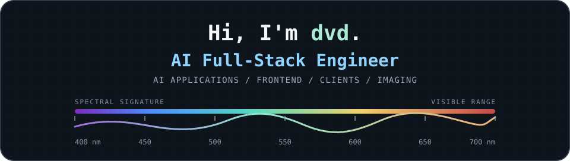
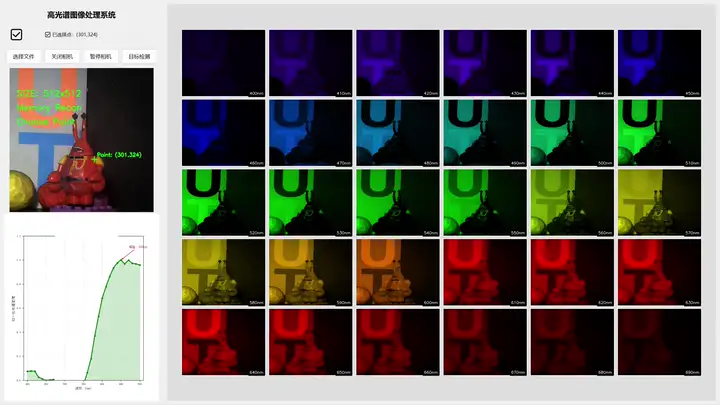
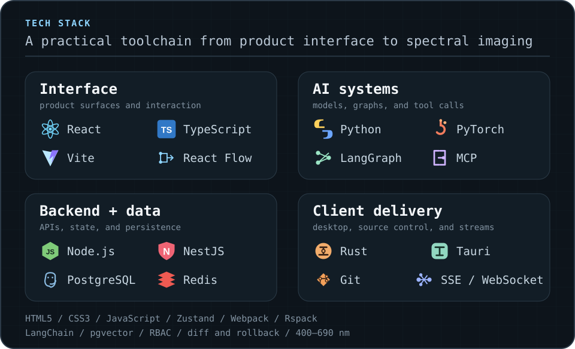
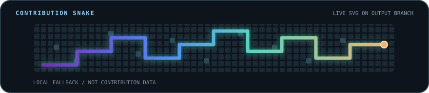
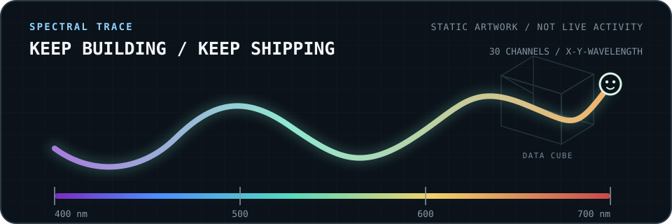

<!--
  Visual direction: a real spectral workflow leads; authored identity,
  capability groups, and contribution proof follow. Local SVGs carry
  the visual system, while the contribution snake, footprint table,
  trophy, streak, and calendar cards are generated by scheduled GitHub
  Actions from public activity data.
-->

  

  

  

Click the preview to play the full demo (muted) · 10.75 s · 1920x1080 · 60 fps video · 400–700 nm.

## Hyperspectral reconstruction demo

This is an **earlier private hyperspectral reconstruction prototype**, shared here as a public demo. The desktop workflow covers camera capture, 30-band reconstruction across 400–700 nm, and interactive spectral visualization.

My contributions covered lightweight deep-learning reconstruction, dataset work, and the desktop workflow—from camera capture and the UI to spectral visualization and result saving. Code and data remain private because of research and industry-collaboration constraints.

  <code>AI applications</code>&nbsp;&nbsp;
  <code>frontend + client systems</code>&nbsp;&nbsp;
  <code>agent workflows</code>&nbsp;&nbsp;
  <code>computational imaging</code>

## Tech stack

  

## AI development tools

  

    

      &nbsp;<strong>Kimi Code</strong>&ensp;
      &nbsp;<strong>Codex</strong>&ensp;
      &nbsp;<strong>Pi</strong>&ensp;
      &nbsp;<strong>Claude Code</strong>
    

    

      &nbsp;<strong>Hermes</strong>&ensp;
      &nbsp;<strong>OpenCode</strong>&ensp;
      &nbsp;<strong>ZCode</strong>&ensp;
      &nbsp;<strong>DeepSeek Harness</strong>
    

  

## 🌐 Open-source contributions

I contribute fixes and features focused on agent interoperability, reliable developer tools, and frontend interactions.

### 🏆 Merged contributions

Selected merged contributions across major Chinese AI agent and frontend ecosystems:

- 🐜 [ant-design/ant-design#59173](https://github.com/ant-design/ant-design/pull/59173) · ⭐ 99.8k — fixed the Chinese contribution guide to link the English locale list in its i18n step, so contributors update both locale lists.
- 🔍 [alibaba/open-code-review](https://github.com/alibaba/open-code-review) · ⭐ 47.5k — preserved configuration and report integrity: atomic writes prevent truncated reports after interruption ([#1160](https://github.com/alibaba/open-code-review/pull/1160)), and config updates retain unknown provider and MCP fields ([#1508](https://github.com/alibaba/open-code-review/pull/1508)). Also expanded template support ([#1114](https://github.com/alibaba/open-code-review/pull/1114), [#1056](https://github.com/alibaba/open-code-review/pull/1056)) and kept long session metadata readable on mobile ([#1458](https://github.com/alibaba/open-code-review/pull/1458)).
- 🧠 [volcengine/OpenViking](https://github.com/volcengine/OpenViking) · ⭐ 40.1k — restored DeepSeek Harness memory injection compatibility while retaining legacy replay ([#5318](https://github.com/volcengine/OpenViking/pull/5318)), fixed broad MCP recall being narrowed to the process workspace ([#5346](https://github.com/volcengine/OpenViking/pull/5346)), and kept OpenCode plugin state snapshots free of captured message parts ([#5179](https://github.com/volcengine/OpenViking/pull/5179)).
- 📱 [NervJS/taro](https://github.com/NervJS/taro) · ⭐ 37.7k — improved cross-platform compatibility through eight merged fixes: page styles and image layout ([#19492](https://github.com/NervJS/taro/pull/19492), [#19491](https://github.com/NervJS/taro/pull/19491)), mini-program props and request/payment typings ([#19493](https://github.com/NervJS/taro/pull/19493), [#19494](https://github.com/NervJS/taro/pull/19494), [#19495](https://github.com/NervJS/taro/pull/19495), [#19496](https://github.com/NervJS/taro/pull/19496)), and RN upload filenames plus Babel preset installation ([#19507](https://github.com/NervJS/taro/pull/19507), [#19521](https://github.com/NervJS/taro/pull/19521)).
- 🤖 [agentscope-ai/agentscope#2434](https://github.com/agentscope-ai/agentscope/pull/2434) · ⭐ 33.4k — Uvicorn hot reload forced a SelectorEventLoop on Windows and broke subprocess execution; disabling reload on Windows keeps a compatible event loop.
- 📖 [Tencent/WeKnora](https://github.com/Tencent/WeKnora) · ⭐ 34.4k — improved MCP and CLI result handling: exposed structured wiki output ([#3590](https://github.com/Tencent/WeKnora/pull/3590)), surfaced container lookup failures and interrupted pagination as errors ([#3611](https://github.com/Tencent/WeKnora/pull/3611), [#3983](https://github.com/Tencent/WeKnora/pull/3983)), and restored paginated text output ([#3984](https://github.com/Tencent/WeKnora/pull/3984)). Also preserved the caret during Markdown list outdenting so the next keystroke does not replace the line ([#4071](https://github.com/Tencent/WeKnora/pull/4071)).
- 💬 [QwenLM/qwen-code](https://github.com/QwenLM/qwen-code) · ⭐ 28.5k — protected branch commits and improved MCP interoperability through eight merged fixes: commit preservation after hook failure ([#11300](https://github.com/QwenLM/qwen-code/pull/11300)), registration URLs and optional-method status ([#12205](https://github.com/QwenLM/qwen-code/pull/12205), [#12500](https://github.com/QwenLM/qwen-code/pull/12500)), ACP and toolchain diagnostics ([#12256](https://github.com/QwenLM/qwen-code/pull/12256), [#12367](https://github.com/QwenLM/qwen-code/pull/12367), [#12268](https://github.com/QwenLM/qwen-code/pull/12268)), read-only sed recognition ([#12221](https://github.com/QwenLM/qwen-code/pull/12221)), and deferred MCP tool calls in SDK E2E ([#12365](https://github.com/QwenLM/qwen-code/pull/12365)).
- ⚛️ [alibaba/hooks#2956](https://github.com/alibaba/hooks/pull/2956) · ⭐ 15.0k — kept `useLatest` and `useUnmountedRef` returns as non-nullable `MutableRefObject` across the supported React type versions, backed by declaration-emission regression tests.
- 🎨 [DouyinFE/semi-design#3352](https://github.com/DouyinFE/semi-design/pull/3352) · ⭐ 10.4k — made ESC close only the top-most modal, so stacked modals no longer collapse together.
- 🛠️ [Tencent/teamai-cli](https://github.com/Tencent/teamai-cli) · ⭐ 5.5k — improved team-sync consistency and agent-hook lifecycle handling through nine merged fixes: explicit-branch pushes that protect local changes ([#690](https://github.com/Tencent/teamai-cli/pull/690), [#820](https://github.com/Tencent/teamai-cli/pull/820)), opt-in DeepSeek Harness hooks with uninstall cleanup ([#689](https://github.com/Tencent/teamai-cli/pull/689)), deletion mirroring and namespaced rule paths ([#651](https://github.com/Tencent/teamai-cli/pull/651), [#654](https://github.com/Tencent/teamai-cli/pull/654)), shared instructions and docs paths ([#653](https://github.com/Tencent/teamai-cli/pull/653), [#652](https://github.com/Tencent/teamai-cli/pull/652)), OpenCode listener cleanup ([#688](https://github.com/Tencent/teamai-cli/pull/688)), and role preservation at init ([#765](https://github.com/Tencent/teamai-cli/pull/765)).
- 🍒 [Tencent/cherry-markdown](https://github.com/Tencent/cherry-markdown) · ⭐ 4.9k — guarded pending image load and error callbacks after previewer destroy ([#1871](https://github.com/Tencent/cherry-markdown/pull/1871)), and centered toolbar menu icons and text across font sizes and wrapped labels ([#1898](https://github.com/Tencent/cherry-markdown/pull/1898)).
- 🧩 [Tencent/tdesign-vue-next](https://github.com/Tencent/tdesign-vue-next) · ⭐ 2.2k — restored the Dropdown `onClick` option type ([#6959](https://github.com/Tencent/tdesign-vue-next/pull/6959)), made Menu handle functional submenu parents ([#6967](https://github.com/Tencent/tdesign-vue-next/pull/6967)), restored retained InputNumber values after clearing and blurring ([#6995](https://github.com/Tencent/tdesign-vue-next/pull/6995)), and synchronized TreeSelect all-mode values when removing tags ([#6998](https://github.com/Tencent/tdesign-vue-next/pull/6998)).
- 🔬 [web-infra-dev/rsdoctor](https://github.com/web-infra-dev/rsdoctor) · ⭐ 1.1k — improved bundle-analysis accuracy and navigation: size filters now honor the selected units ([#2075](https://github.com/web-infra-dev/rsdoctor/pull/2075)), module trees can be sorted by bundled or source size ([#2101](https://github.com/web-infra-dev/rsdoctor/pull/2101)), and Windows path normalization restores module-size measurements that incorrectly stayed at zero ([#2102](https://github.com/web-infra-dev/rsdoctor/pull/2102)).

Merged in international frontend and tooling ecosystems:

- 🧱 [mui/material-ui#49318](https://github.com/mui/material-ui/pull/49318) · ⭐ 99.2k — fixed inline completion for automatically highlighted Autocomplete options, while preserving typed input, text selection, and freeSolo behavior.
- ⚡ [chakra-ui/chakra-ui#10979](https://github.com/chakra-ui/chakra-ui/pull/10979) · ⭐ 40.7k — gave the file-upload delete trigger a proper disabled style.
- 📦 [pnpm/pnpm#14708](https://github.com/pnpm/pnpm/pull/14708) · ⭐ 36.8k — stopped emitting empty package authors in SBOM documents.

**30 merged PRs in [grafana/grafana-pathfinder-app](https://github.com/grafana/grafana-pathfinder-app)** · ⭐ 21 — sustained features, fixes, and hardening that span Grafana's interactive learning app end to end: block-editor bulk actions, coda VM lifecycle, docs retrieval, and lint plus e2e coverage.

**27 merged PRs in [open-city-ai/haidian](https://github.com/open-city-ai/haidian)** — selected deep dives:

  
<strong>🥇 Complete delivery · bilingual formal submission</strong>

  **Problem**: A civic-data submission needed a complete, reviewable package rather than an unsupported concept.

  **Contribution**: I delivered a scoped 41-file bilingual package spanning narrative, offline HTML/PDF, GeoJSON, metrics, sources, a manifest, and deterministic self-checks, while marking provisional geometry and non-endorsement boundaries.

  **PR**: [open-city-ai/haidian#2540](https://github.com/open-city-ai/haidian/pull/2540) · merged for repository intake, not gallery publication or government endorsement.

  
<strong>🪟 Windows portability · import and worker locking</strong>

  **Problem**: An unconditional <code>fcntl</code> import stopped two test modules from being collected on Windows, and worker-lock contention needed consistent cross-platform semantics.

  **Contribution**: I reproduced the failure, introduced the guarded POSIX and Windows lock path, and added the initial regression. Maintainer review then corrected the production file-open path and strengthened its test; the previously uncollectable target suite passed 21/21 tests.

  **PR**: [open-city-ai/haidian#3859](https://github.com/open-city-ai/haidian/pull/3859)

  
<strong>⚖️ Review semantics · blockers versus future follow-ups</strong>

  **Problem**: A flat review-action list converted future conditions into immediate change requests, creating an intake loop that compliant edits could not close.

  **Contribution**: I introduced explicit non-blocking follow-ups with trigger and owner fields, invalidated legacy review caches, and kept current or malformed repairs fail-closed with focused regression coverage.

  **PR**: [open-city-ai/haidian#3982](https://github.com/open-city-ai/haidian/pull/3982); the original blocked head was re-reviewed and merged without weakening existing gates.

### 🗺️ Contribution map

<strong>🗺️ Explore contributions by area</strong>

| Area | Project | Status | Selected work |
|---|---|---|---|
| 🎓 **Interactive learning tooling** | [grafana/grafana-pathfinder-app](https://github.com/grafana/grafana-pathfinder-app) | `31 PRs · 30 merged · 1 open` | Block editor bulk actions, coda VM lifecycle, docs retrieval, and lint plus e2e coverage |
| 🏙️ **Civic data delivery** | [open-city-ai/haidian](https://github.com/open-city-ai/haidian) | `28 PRs · 27 merged` | Structured submissions, geometry sources, deterministic artifacts, review semantics, and a CJK font screenshot regression |
| 🤖 **AI agent systems** | [agentscope-ai/agentscope](https://github.com/agentscope-ai/agentscope) · [QwenLM/qwen-code](https://github.com/QwenLM/qwen-code) | `9 merged · 5 open` | Windows event-loop, post-checkout commit safety, and MCP registration plus status fixes merged; open PRs address tool data-block replay and output language |
| 🧩 **Frontend component ecosystems** | [ant-design/ant-design](https://github.com/ant-design/ant-design) · [chakra-ui/chakra-ui](https://github.com/chakra-ui/chakra-ui) · [DouyinFE/semi-design](https://github.com/DouyinFE/semi-design) · [alibaba/hooks](https://github.com/alibaba/hooks) · [nuxt/ui](https://github.com/nuxt/ui) · [Tencent/tdesign-vue-next](https://github.com/Tencent/tdesign-vue-next) · [Tencent/cherry-markdown](https://github.com/Tencent/cherry-markdown) · [mui/material-ui](https://github.com/mui/material-ui) | `13 merged · 5 open` | i18n guide links, modal stacking, ref types, input and selection behavior, toolbar alignment, and upload triggers |
| 🔍 **Code review tooling** | [alibaba/open-code-review](https://github.com/alibaba/open-code-review) | `6 PRs · 5 merged` | Pug and Jinja support, atomic report writes, unknown config-field preservation, and mobile viewer wrapping merged |
| 🔐 **AI safety & evaluation** | [microsoft/PyRIT](https://github.com/microsoft/PyRIT) · [wandb/rai-toolkit](https://github.com/wandb/rai-toolkit) | `2 merged` | Feedback-dialog restore after secret confirmation; explicit adapter call-time options |
| 🛠️ **Web & build tooling** | [pnpm/pnpm](https://github.com/pnpm/pnpm) · [crxjs/chrome-extension-tools](https://github.com/crxjs/chrome-extension-tools) · [storybookjs/storybook](https://github.com/storybookjs/storybook) · [parcel-bundler/parcel](https://github.com/parcel-bundler/parcel) · [web-infra-dev/rsdoctor](https://github.com/web-infra-dev/rsdoctor) | `6 merged · 2 open` | SBOM, sourcemap paths, bundle-size filters and sorting, and Next.js-Vite resolution fixes merged; resolver BOM parsing fix remains open |
| 💻 **Desktop UX** | [desktop/desktop](https://github.com/desktop/desktop) · [kando-menu/kando](https://github.com/kando-menu/kando) | `1 merged · 1 open` | WebSocket message action merged; pull-request suggestion fix remains open |
| 🧠 **Agent memory & Node.js** | [TencentCloud/TencentDB-Agent-Memory](https://github.com/TencentCloud/TencentDB-Agent-Memory) | `1 merged · 5 open` | Auto-Sync documentation merged; open PRs address Gateway lifecycle, timestamps, proxy preservation, SQLite filtering, and store initialization |
| 📱 **Cross-end frontend** | [NervJS/taro](https://github.com/NervJS/taro) · [NervJS/taro-docs](https://github.com/NervJS/taro-docs) | `8 merged · 1 open` | Shared CSS output, image centering, typings, swan input, and RN upload plus Babel preset fixes merged; documentation update remains open |
| 🖥️ **Agent desktop UI** | [bytedance/UI-TARS-desktop](https://github.com/bytedance/UI-TARS-desktop) | `8 open` | Agent server streaming, MCP initialization, device actions, and workspace search ordering |
| 📖 **Knowledge & RAG** | [Tencent/WeKnora](https://github.com/Tencent/WeKnora) | `5 merged · 3 open` | Wiki MCP structured content, container lookup errors, CLI pagination, and Markdown caret fixes merged; open PRs cover PDF extraction and other document fixes |
| 🧭 **Search & coordinates** | [organicmaps/organicmaps](https://github.com/organicmaps/organicmaps) | `1 open` | C++ search behavior for space-separated DMS coordinates |

### 🚀 Open pull requests

  
<strong>🤖 AI agent systems · 21 open PRs</strong>

  - [TencentCloud/TencentDB-Agent-Memory#1383](https://github.com/TencentCloud/TencentDB-Agent-Memory/pull/1383): terminate the Gateway process tree on Windows.
  - [TencentCloud/TencentDB-Agent-Memory#1272](https://github.com/TencentCloud/TencentDB-Agent-Memory/pull/1272): emit local-time ISO 8601 timestamps from the knowledge logger.
  - [TencentCloud/TencentDB-Agent-Memory#1173](https://github.com/TencentCloud/TencentDB-Agent-Memory/pull/1173): honor <code>recordIds</code> filtering in the SQLite L1 query path.
  - [TencentCloud/TencentDB-Agent-Memory#1172](https://github.com/TencentCloud/TencentDB-Agent-Memory/pull/1172): self-heal the store-init cache after failed initialization or a closed store.
  - [TencentCloud/TencentDB-Agent-Memory#1171](https://github.com/TencentCloud/TencentDB-Agent-Memory/pull/1171): keep Node's global proxy dispatcher intact while loading <code>undici@8</code>.
  - [bytedance/UI-TARS-desktop#1982](https://github.com/bytedance/UI-TARS-desktop/pull/1982): reject existing move destinations in the MCP filesystem server.
  - [bytedance/UI-TARS-desktop#1981](https://github.com/bytedance/UI-TARS-desktop/pull/1981): allow recursive directory creation in the MCP filesystem server.
  - [bytedance/UI-TARS-desktop#1979](https://github.com/bytedance/UI-TARS-desktop/pull/1979): preserve literal edit replacement text in the MCP filesystem server.
  - [bytedance/UI-TARS-desktop#1961](https://github.com/bytedance/UI-TARS-desktop/pull/1961): prioritize source workspace results in the contextual selector.
  - [bytedance/UI-TARS-desktop#1960](https://github.com/bytedance/UI-TARS-desktop/pull/1960): surface MCP agent initialization failures.
  - [bytedance/UI-TARS-desktop#1959](https://github.com/bytedance/UI-TARS-desktop/pull/1959): add default search exclusions to the MCP filesystem server.
  - [bytedance/UI-TARS-desktop#1958](https://github.com/bytedance/UI-TARS-desktop/pull/1958): await asynchronous ADB device actions.
  - [bytedance/UI-TARS-desktop#1957](https://github.com/bytedance/UI-TARS-desktop/pull/1957): release the exclusive slot when agent-server stream startup fails.
  - [QwenLM/qwen-code#12484](https://github.com/QwenLM/qwen-code/pull/12484): explain discontinued qwen-oauth typed model selections.
  - [QwenLM/qwen-code#12227](https://github.com/QwenLM/qwen-code/pull/12227): preserve activity state during slash dispatch.
  - [QwenLM/qwen-code#11794](https://github.com/QwenLM/qwen-code/pull/11794): honor the configured output language in stateless generation.
  - [QwenLM/qwen-code#10580](https://github.com/QwenLM/qwen-code/pull/10580): localize untitled session search in the VS Code integration.
  - [agentscope-ai/agentscope#2551](https://github.com/agentscope-ai/agentscope/pull/2551): preserve tool data-block identity during event replay.
  - [Tencent/WeKnora#3592](https://github.com/Tencent/WeKnora/pull/3592): prevent large spreadsheet preview crashes.
  - [Tencent/WeKnora#3499](https://github.com/Tencent/WeKnora/pull/3499): accept SQL uploads and route them through MarkItDown.
  - [Tencent/WeKnora#3228](https://github.com/Tencent/WeKnora/pull/3228): preserve numeric rows in PDF text extraction.

  
<strong>📱 Cross-end and domestic frontend · 4 open PRs</strong>

  - [Tencent/vConsole#739](https://github.com/Tencent/vConsole/pull/739): guard reserved request IDs against prototype pollution in the Network panel.
  - [Tencent/vConsole#737](https://github.com/Tencent/vConsole/pull/737): restore inherited event properties in log output.
  - [baidu/amis#21525](https://github.com/baidu/amis/pull/21525): allow spaces in table quick-edit inputs.
  - [baidu/amis#21517](https://github.com/baidu/amis/pull/21517): restore list order on drag reset.

  
<strong>🛠️ Frontend platforms and tooling · 9 open PRs</strong>

  - [storybookjs/storybook#36358](https://github.com/storybookjs/storybook/pull/36358): preserve empty string args in story URLs.
  - [TanStack/router#8438](https://github.com/TanStack/router/pull/8438): hydrate route error components consistently in the Solid router.
  - [TanStack/router#8283](https://github.com/TanStack/router/pull/8283): reject non-ok JSON server function responses.
  - [radix-ui/primitives#4145](https://github.com/radix-ui/primitives/pull/4145): prevent Escape from dismissing the underlying layer.
  - [radix-ui/primitives#4142](https://github.com/radix-ui/primitives/pull/4142): finish toast swipes when pointer capture is lost.
  - [adobe/react-spectrum#10629](https://github.com/adobe/react-spectrum/pull/10629): use the document viewport for page-scrolling LoadMoreItems.
  - [adobe/react-spectrum#10619](https://github.com/adobe/react-spectrum/pull/10619): support disabling entire listboxes.
  - [adobe/react-spectrum#10596](https://github.com/adobe/react-spectrum/pull/10596): preserve the active FocusScope when a sibling unmounts.
  - [adobe/react-spectrum#10595](https://github.com/adobe/react-spectrum/pull/10595): scope ariaHideOutside to the target document.

…plus more PRs across MiniMax agent ecosystems, denoland/std, parcel, desktop/desktop, payloadcms, continue, eslint, NextChat, OpenViking, and other ecosystems — the auto-refreshed 📊 Full footprint below tracks every upstream project.

### 📊 Full footprint

<!--START_SECTION:oss-footprint-->
| Project | ⭐ | PRs | ✅ Merged | 🚀 Open |
|:---|:---:|:---:|:---:|:---:|
| **Total across 162 upstream projects** |  | **405** | **173** | **181** |

<strong>✅ 61 projects with merged PRs</strong>

| Project | ⭐ | PRs | ✅ Merged | 🚀 Open |
|:---|:---:|:---:|:---:|:---:|
| [`grafana/grafana-pathfinder-app`](https://github.com/grafana/grafana-pathfinder-app) | 21 | 31 | 30 | 1 |
| [`open-city-ai/haidian`](https://github.com/open-city-ai/haidian) | 416 | 28 | 27 | 0 |
| [`Tencent/teamai-cli`](https://github.com/Tencent/teamai-cli) | 5542 | 11 | 9 | 0 |
| [`NervJS/taro`](https://github.com/NervJS/taro) | 37713 | 8 | 8 | 0 |
| [`QwenLM/qwen-code`](https://github.com/QwenLM/qwen-code) | 28554 | 12 | 8 | 4 |
| [`PKU-YuanGroup/OpenAI4S`](https://github.com/PKU-YuanGroup/OpenAI4S) | 628 | 10 | 7 | 3 |
| [`alibaba/open-code-review`](https://github.com/alibaba/open-code-review) | 47557 | 6 | 5 | 0 |
| [`Tencent/WeKnora`](https://github.com/Tencent/WeKnora) | 34554 | 11 | 5 | 3 |
| [`Tencent/tdesign-vue-next`](https://github.com/Tencent/tdesign-vue-next) | 2199 | 5 | 4 | 1 |
| [`michaelegner/architecture-intelligence-platform`](https://github.com/michaelegner/architecture-intelligence-platform) | 8 | 4 | 4 | 0 |
| [`volcengine/OpenViking`](https://github.com/volcengine/OpenViking) | 40210 | 5 | 3 | 1 |
| [`web-infra-dev/rsdoctor`](https://github.com/web-infra-dev/rsdoctor) | 1147 | 3 | 3 | 0 |
| [`AgentPostmortem/agentpostmortem`](https://github.com/AgentPostmortem/agentpostmortem) | 2 | 3 | 3 | 0 |
| [`Tencent/omi`](https://github.com/Tencent/omi) | 13276 | 2 | 2 | 0 |
| [`antvis/G2`](https://github.com/antvis/G2) | 12637 | 2 | 2 | 0 |
| [`wxt-dev/wxt`](https://github.com/wxt-dev/wxt) | 10621 | 3 | 2 | 1 |
| [`bytedance/xgplayer`](https://github.com/bytedance/xgplayer) | 9304 | 4 | 2 | 0 |
| [`bytedance/flowgram.ai`](https://github.com/bytedance/flowgram.ai) | 8498 | 4 | 2 | 2 |
| [`nuxt/ui`](https://github.com/nuxt/ui) | 7016 | 2 | 2 | 0 |
| [`Tencent/cherry-markdown`](https://github.com/Tencent/cherry-markdown) | 4905 | 2 | 2 | 0 |
| [`snapotter-hq/SnapOtter`](https://github.com/snapotter-hq/SnapOtter) | 2824 | 2 | 2 | 0 |
| [`reticlehq/reticle`](https://github.com/reticlehq/reticle) | 1253 | 2 | 2 | 0 |
| [`ant-design/ant-design`](https://github.com/ant-design/ant-design) | 99804 | 1 | 1 | 0 |
| [`mui/material-ui`](https://github.com/mui/material-ui) | 99237 | 1 | 1 | 0 |
| [`storybookjs/storybook`](https://github.com/storybookjs/storybook) | 91322 | 4 | 1 | 1 |
| [`cline/cline`](https://github.com/cline/cline) | 70489 | 1 | 1 | 0 |
| [`chakra-ui/chakra-ui`](https://github.com/chakra-ui/chakra-ui) | 40687 | 1 | 1 | 0 |
| [`pnpm/pnpm`](https://github.com/pnpm/pnpm) | 36830 | 2 | 1 | 0 |
| [`agentscope-ai/agentscope`](https://github.com/agentscope-ai/agentscope) | 33441 | 3 | 1 | 1 |
| [`mantinedev/mantine`](https://github.com/mantinedev/mantine) | 31835 | 1 | 1 | 0 |
| [`TencentCloud/TencentDB-Agent-Memory`](https://github.com/TencentCloud/TencentDB-Agent-Memory) | 29531 | 8 | 1 | 5 |
| [`facebook/lexical`](https://github.com/facebook/lexical) | 23961 | 2 | 1 | 1 |
| [`camsong/You-Dont-Need-jQuery`](https://github.com/camsong/You-Dont-Need-jQuery) | 20119 | 1 | 1 | 0 |
| [`eggjs/egg`](https://github.com/eggjs/egg) | 18985 | 1 | 1 | 0 |
| [`langchain-ai/langchainjs`](https://github.com/langchain-ai/langchainjs) | 18276 | 2 | 1 | 1 |
| [`alibaba/hooks`](https://github.com/alibaba/hooks) | 14973 | 4 | 1 | 3 |
| [`antvis/G6`](https://github.com/antvis/G6) | 12337 | 3 | 1 | 2 |
| [`DouyinFE/semi-design`](https://github.com/DouyinFE/semi-design) | 10413 | 2 | 1 | 1 |
| [`gridstack/gridstack.js`](https://github.com/gridstack/gridstack.js) | 9205 | 1 | 1 | 0 |
| [`Tencent/BrowserSkill`](https://github.com/Tencent/BrowserSkill) | 9127 | 1 | 1 | 0 |
| [`dequelabs/axe-core`](https://github.com/dequelabs/axe-core) | 7659 | 1 | 1 | 0 |
| [`Tencent/AI-Infra-Guard`](https://github.com/Tencent/AI-Infra-Guard) | 6898 | 1 | 1 | 0 |
| [`kando-menu/kando`](https://github.com/kando-menu/kando) | 6473 | 1 | 1 | 0 |
| [`conorbronsdon/avoid-ai-writing`](https://github.com/conorbronsdon/avoid-ai-writing) | 5074 | 1 | 1 | 0 |
| [`callstack/agent-device`](https://github.com/callstack/agent-device) | 5062 | 1 | 1 | 0 |
| [`microsoft/PyRIT`](https://github.com/microsoft/PyRIT) | 4645 | 1 | 1 | 0 |
| [`crxjs/chrome-extension-tools`](https://github.com/crxjs/chrome-extension-tools) | 4180 | 1 | 1 | 0 |
| [`add2cal/add-to-calendar-button`](https://github.com/add2cal/add-to-calendar-button) | 1487 | 1 | 1 | 0 |
| [`libredb/libredb-studio`](https://github.com/libredb/libredb-studio) | 1229 | 1 | 1 | 0 |
| [`PostHog/posthog-js`](https://github.com/PostHog/posthog-js) | 633 | 1 | 1 | 0 |
| [`VisActor/VRender`](https://github.com/VisActor/VRender) | 264 | 1 | 1 | 0 |
| [`OpsiMate/OpsiMate`](https://github.com/OpsiMate/OpsiMate) | 253 | 1 | 1 | 0 |
| [`Tencent/tdesign-common`](https://github.com/Tencent/tdesign-common) | 193 | 2 | 1 | 1 |
| [`agentic-ai-java/argi`](https://github.com/agentic-ai-java/argi) | 120 | 1 | 1 | 0 |
| [`wandb/rai-toolkit`](https://github.com/wandb/rai-toolkit) | 50 | 1 | 1 | 0 |
| [`NimbleBrainInc/nimblebrain`](https://github.com/NimbleBrainInc/nimblebrain) | 25 | 1 | 1 | 0 |
| [`KnobanLabs/MeshCore-Desktop`](https://github.com/KnobanLabs/MeshCore-Desktop) | 9 | 1 | 1 | 0 |
| [`Tnsor-Labs/brokoli`](https://github.com/Tnsor-Labs/brokoli) | 8 | 1 | 1 | 0 |
| [`AubaidFarrukh/smart-retry`](https://github.com/AubaidFarrukh/smart-retry) | 2 | 1 | 1 | 0 |
| [`exactml/marginal`](https://github.com/exactml/marginal) | 1 | 1 | 1 | 0 |
| [`theaiteam-dev/conduit`](https://github.com/theaiteam-dev/conduit) | 0 | 1 | 1 | 0 |

<strong>🧾 101 projects with PRs only in review or closed without merge</strong>

| Project | ⭐ | PRs | ✅ Merged | 🚀 Open |
|:---|:---:|:---:|:---:|:---:|
| [`bytedance/UI-TARS-desktop`](https://github.com/bytedance/UI-TARS-desktop) | 39311 | 9 | 0 | 8 |
| [`MiniMax-AI/skills`](https://github.com/MiniMax-AI/skills) | 13708 | 5 | 0 | 5 |
| [`ant-design/x`](https://github.com/ant-design/x) | 4813 | 5 | 0 | 5 |
| [`adobe/react-spectrum`](https://github.com/adobe/react-spectrum) | 15959 | 4 | 0 | 4 |
| [`MiniMax-AI/Mini-Agent`](https://github.com/MiniMax-AI/Mini-Agent) | 3056 | 4 | 0 | 4 |
| [`Tencent/tdesign-react`](https://github.com/Tencent/tdesign-react) | 971 | 4 | 0 | 4 |
| [`MiniMax-AI/MiniMax-MCP-JS`](https://github.com/MiniMax-AI/MiniMax-MCP-JS) | 130 | 4 | 0 | 4 |
| [`baidu/amis`](https://github.com/baidu/amis) | 18891 | 3 | 0 | 3 |
| [`Tencent/vConsole`](https://github.com/Tencent/vConsole) | 17532 | 3 | 0 | 3 |
| [`freshframework/fresh`](https://github.com/freshframework/fresh) | 13793 | 3 | 0 | 3 |
| [`alibaba/formily`](https://github.com/alibaba/formily) | 12585 | 3 | 0 | 3 |
| [`didi/LogicFlow`](https://github.com/didi/LogicFlow) | 11742 | 3 | 0 | 3 |
| [`huggingface/chat-ui`](https://github.com/huggingface/chat-ui) | 10988 | 4 | 0 | 3 |
| [`ecomfe/zrender`](https://github.com/ecomfe/zrender) | 6310 | 3 | 0 | 3 |
| [`arco-design/arco-design`](https://github.com/arco-design/arco-design) | 5733 | 3 | 0 | 3 |
| [`denoland/std`](https://github.com/denoland/std) | 3560 | 3 | 0 | 3 |
| [`MiniMax-AI/cli`](https://github.com/MiniMax-AI/cli) | 2193 | 6 | 0 | 3 |
| [`deepseek-ai/deepseek-recipe`](https://github.com/deepseek-ai/deepseek-recipe) | 414 | 4 | 0 | 3 |
| [`payloadcms/payload`](https://github.com/payloadcms/payload) | 45317 | 2 | 0 | 2 |
| [`youzan/vant`](https://github.com/youzan/vant) | 24391 | 2 | 0 | 2 |
| [`radix-ui/primitives`](https://github.com/radix-ui/primitives) | 19402 | 2 | 0 | 2 |
| [`TanStack/router`](https://github.com/TanStack/router) | 15214 | 2 | 0 | 2 |
| [`MoonshotAI/kimi-cli`](https://github.com/MoonshotAI/kimi-cli) | 11415 | 3 | 0 | 2 |
| [`alibaba/x-render`](https://github.com/alibaba/x-render) | 7852 | 2 | 0 | 2 |
| [`zai-org/GLM-OCR`](https://github.com/zai-org/GLM-OCR) | 7519 | 2 | 0 | 2 |
| [`zai-org/GLM-4`](https://github.com/zai-org/GLM-4) | 7068 | 2 | 0 | 2 |
| [`antvis/Infographic`](https://github.com/antvis/Infographic) | 7010 | 2 | 0 | 2 |
| [`antvis/X6`](https://github.com/antvis/X6) | 6731 | 2 | 0 | 2 |
| [`Tencent/wujie`](https://github.com/Tencent/wujie) | 5051 | 2 | 0 | 2 |
| [`Tencent/WeSmartFlow`](https://github.com/Tencent/WeSmartFlow) | 1061 | 2 | 0 | 2 |
| [`react-component/select`](https://github.com/react-component/select) | 939 | 2 | 0 | 2 |
| [`MoonshotAI/kimi-agent-sdk`](https://github.com/MoonshotAI/kimi-agent-sdk) | 577 | 2 | 0 | 2 |
| [`MiniMax-AI/OpenAgentCore`](https://github.com/MiniMax-AI/OpenAgentCore) | 233 | 2 | 0 | 2 |
| [`zai-org/zcode-plugins`](https://github.com/zai-org/zcode-plugins) | 103 | 2 | 0 | 2 |
| [`ChatGPTNextWeb/NextChat`](https://github.com/ChatGPTNextWeb/NextChat) | 88854 | 1 | 0 | 1 |
| [`code-yeongyu/oh-my-openagent`](https://github.com/code-yeongyu/oh-my-openagent) | 70153 | 1 | 0 | 1 |
| [`parcel-bundler/parcel`](https://github.com/parcel-bundler/parcel) | 44007 | 1 | 0 | 1 |
| [`streamich/react-use`](https://github.com/streamich/react-use) | 43990 | 1 | 0 | 1 |
| [`CopilotKit/CopilotKit`](https://github.com/CopilotKit/CopilotKit) | 38087 | 1 | 0 | 1 |
| [`continuedev/continue`](https://github.com/continuedev/continue) | 36240 | 1 | 0 | 1 |
| [`floating-ui/floating-ui`](https://github.com/floating-ui/floating-ui) | 32754 | 1 | 0 | 1 |
| [`alibaba/page-agent`](https://github.com/alibaba/page-agent) | 29475 | 2 | 0 | 1 |
| [`tailwindlabs/headlessui`](https://github.com/tailwindlabs/headlessui) | 28780 | 1 | 0 | 1 |
| [`OtterMind/Chat2DB`](https://github.com/OtterMind/Chat2DB) | 28321 | 1 | 0 | 1 |
| [`eslint/eslint`](https://github.com/eslint/eslint) | 27567 | 1 | 0 | 1 |
| [`zai-org/Open-AutoGLM`](https://github.com/zai-org/Open-AutoGLM) | 26426 | 1 | 0 | 1 |
| [`browserbase/stagehand`](https://github.com/browserbase/stagehand) | 25720 | 1 | 0 | 1 |
| [`desktop/desktop`](https://github.com/desktop/desktop) | 21976 | 1 | 0 | 1 |
| [`QwenLM/Qwen-Agent`](https://github.com/QwenLM/Qwen-Agent) | 17186 | 1 | 0 | 1 |
| [`umijs/umi`](https://github.com/umijs/umi) | 16038 | 1 | 0 | 1 |
| [`organicmaps/organicmaps`](https://github.com/organicmaps/organicmaps) | 15696 | 1 | 0 | 1 |
| [`lynx-family/lynx`](https://github.com/lynx-family/lynx) | 15193 | 1 | 0 | 1 |
| [`alibaba/spring-ai-alibaba`](https://github.com/alibaba/spring-ai-alibaba) | 11031 | 1 | 0 | 1 |
| [`evidence-dev/evidence`](https://github.com/evidence-dev/evidence) | 7032 | 1 | 0 | 1 |
| [`jd-opensource/nutui`](https://github.com/jd-opensource/nutui) | 6510 | 1 | 0 | 1 |
| [`jd-opensource/micro-app`](https://github.com/jd-opensource/micro-app) | 6260 | 1 | 0 | 1 |
| [`coze-dev/coze-loop`](https://github.com/coze-dev/coze-loop) | 5774 | 1 | 0 | 1 |
| [`tencentmusic/supersonic`](https://github.com/tencentmusic/supersonic) | 5133 | 1 | 0 | 1 |
| [`web-infra-dev/modern.js`](https://github.com/web-infra-dev/modern.js) | 5047 | 1 | 0 | 1 |
| [`Tencent/tmagic-editor`](https://github.com/Tencent/tmagic-editor) | 4946 | 1 | 0 | 1 |
| [`alibaba/ChatUI`](https://github.com/alibaba/ChatUI) | 4456 | 1 | 0 | 1 |
| [`zai-org/GLM-4.5`](https://github.com/zai-org/GLM-4.5) | 4425 | 1 | 0 | 1 |
| [`VisActor/VTable`](https://github.com/VisActor/VTable) | 3675 | 1 | 0 | 1 |
| [`arco-design/arco-design-vue`](https://github.com/arco-design/arco-design-vue) | 3111 | 1 | 0 | 1 |
| [`opentiny/tiny-engine`](https://github.com/opentiny/tiny-engine) | 2782 | 1 | 0 | 1 |
| [`Tencent/tdesign-miniprogram`](https://github.com/Tencent/tdesign-miniprogram) | 1779 | 3 | 0 | 1 |
| [`antvis/S2`](https://github.com/antvis/S2) | 1697 | 1 | 0 | 1 |
| [`astral-sh/ruff-vscode`](https://github.com/astral-sh/ruff-vscode) | 1676 | 1 | 0 | 1 |
| [`MiniMax-AI/MiniMax-MCP`](https://github.com/MiniMax-AI/MiniMax-MCP) | 1589 | 1 | 0 | 1 |
| [`react-component/table`](https://github.com/react-component/table) | 1373 | 1 | 0 | 1 |
| [`MiniMax-AI/OpenRoom`](https://github.com/MiniMax-AI/OpenRoom) | 1270 | 1 | 0 | 1 |
| [`Tencent/tdesign-vue`](https://github.com/Tencent/tdesign-vue) | 1033 | 1 | 0 | 1 |
| [`XiaoMi/hiui`](https://github.com/XiaoMi/hiui) | 879 | 1 | 0 | 1 |
| [`web-infra-dev/rstest`](https://github.com/web-infra-dev/rstest) | 506 | 2 | 0 | 1 |
| [`zai-org/Synapse`](https://github.com/zai-org/Synapse) | 462 | 1 | 0 | 1 |
| [`Tencent/tdesign-mobile-vue`](https://github.com/Tencent/tdesign-mobile-vue) | 436 | 1 | 0 | 1 |
| [`ant-design/ant-design-cli`](https://github.com/ant-design/ant-design-cli) | 260 | 1 | 0 | 1 |
| [`MetaGLM/zhipuai-sdk-python-v4`](https://github.com/MetaGLM/zhipuai-sdk-python-v4) | 198 | 1 | 0 | 1 |
| [`DSpace/dspace-angular`](https://github.com/DSpace/dspace-angular) | 178 | 1 | 0 | 1 |
| [`NervJS/taro-project-templates`](https://github.com/NervJS/taro-project-templates) | 92 | 1 | 0 | 1 |
| [`MetaGLM/zhipuai-sdk-nodejs-v4`](https://github.com/MetaGLM/zhipuai-sdk-nodejs-v4) | 64 | 1 | 0 | 1 |
| [`NervJS/taro-docs`](https://github.com/NervJS/taro-docs) | 32 | 1 | 0 | 1 |
| [`ant-design/x-markdown-mini`](https://github.com/ant-design/x-markdown-mini) | 29 | 1 | 0 | 1 |
| [`alibaba/loongsuite-js`](https://github.com/alibaba/loongsuite-js) | 26 | 1 | 0 | 1 |
| [`vitejs/vite`](https://github.com/vitejs/vite) | 83382 | 1 | 0 | 0 |
| [`TanStack/query`](https://github.com/TanStack/query) | 50452 | 1 | 0 | 0 |
| [`langchain-ai/langgraph`](https://github.com/langchain-ai/langgraph) | 43429 | 1 | 0 | 0 |
| [`trpc/trpc`](https://github.com/trpc/trpc) | 40709 | 1 | 0 | 0 |
| [`recharts/recharts`](https://github.com/recharts/recharts) | 27637 | 1 | 0 | 0 |
| [`vitest-dev/vitest`](https://github.com/vitest-dev/vitest) | 17256 | 2 | 0 | 0 |
| [`typescript-eslint/typescript-eslint`](https://github.com/typescript-eslint/typescript-eslint) | 16427 | 4 | 0 | 0 |
| [`assistant-ui/assistant-ui`](https://github.com/assistant-ui/assistant-ui) | 12593 | 1 | 0 | 0 |
| [`deepseek-ai/DeepEP`](https://github.com/deepseek-ai/DeepEP) | 10288 | 1 | 0 | 0 |
| [`ant-design/pro-components`](https://github.com/ant-design/pro-components) | 4836 | 2 | 0 | 0 |
| [`npmx-dev/npmx.dev`](https://github.com/npmx-dev/npmx.dev) | 3641 | 3 | 0 | 0 |
| [`eclipse-paho/paho.mqtt.golang`](https://github.com/eclipse-paho/paho.mqtt.golang) | 3131 | 1 | 0 | 0 |
| [`Gamote/lottie-react`](https://github.com/Gamote/lottie-react) | 969 | 1 | 0 | 0 |
| [`w3c/aria`](https://github.com/w3c/aria) | 755 | 1 | 0 | 0 |
| [`astral-sh/ty-vscode`](https://github.com/astral-sh/ty-vscode) | 379 | 1 | 0 | 0 |
| [`pnpm/pnpm.io`](https://github.com/pnpm/pnpm.io) | 313 | 1 | 0 | 0 |
| [`backblaze-labs/b2-mcp`](https://github.com/backblaze-labs/b2-mcp) | 45 | 1 | 0 | 0 |

<!--END_SECTION:oss-footprint-->

## Contact

[z1403594118@gmail.com](mailto:z1403594118@gmail.com) · [dvd@linux.do](mailto:dvd@linux.do)

## 📈 GitHub activity

  <picture class="trophy-card">
    <source media="(prefers-color-scheme: dark)" srcset="assets/trophy-dark.svg">
    <source media="(prefers-color-scheme: light)" srcset="assets/trophy-light.svg">
    
  </picture>

  <picture class="streak-card">
    <source media="(prefers-color-scheme: dark)" srcset="assets/streak-dark.svg">
    <source media="(prefers-color-scheme: light)" srcset="assets/streak-light.svg">
    
  </picture>

  <picture class="isocalendar-card">
    <source media="(prefers-color-scheme: dark)" srcset="assets/metrics-isocalendar-dark.svg">
    <source media="(prefers-color-scheme: light)" srcset="assets/metrics-isocalendar-light.svg">
    
  </picture>

  <picture class="contribution-snake">
    <source class="contribution-snake-source" media="(prefers-color-scheme: dark)" srcset="https://raw.githubusercontent.com/dvd233/dvd233/output/github-contribution-grid-snake-dark.svg">
    <source class="contribution-snake-source" media="(prefers-color-scheme: light)" srcset="https://raw.githubusercontent.com/dvd233/dvd233/output/github-contribution-grid-snake.svg">
    
  </picture>

  

